# [“Микросервисный проект магазина товаров (spring-microservices)”](https://github.com/Sergistan/spring-microservices)

## Описание

Микросервисный проект представляет собой RESTful API магазина товаров (доступен через Swagger, аутентификация — OAuth 2.0/Keycloak): пользователь может самостоятельно зарегистрироваться (покупателем или курьером) и удалить аккаунт, создать, оплатить и вернуть заказ (возврат возможен в 5-минутном окне после оплаты, затем заказ доставляет курьер с уведомлением по электронной почте и сохранением истории), а админ — добавлять, изменять и удалять товары магазина.

### Схема проекта:

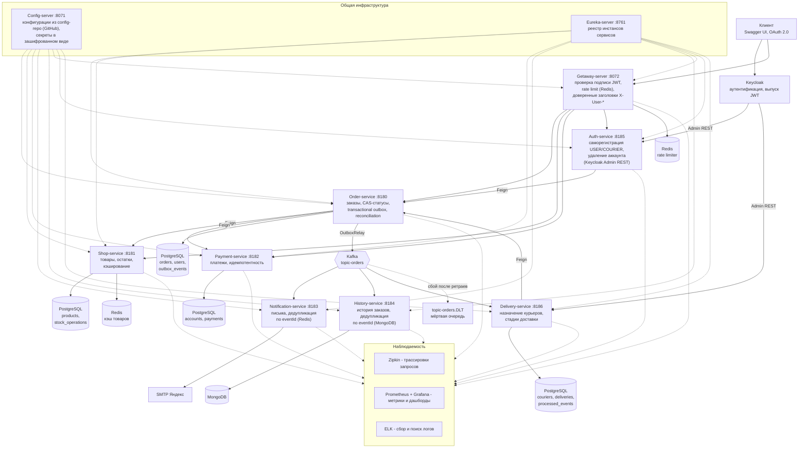

<details>
<summary>Что передаётся по связям схемы (легенда)</summary>

| Связь | Что ходит |
|-------|-----------|
| GW → AUTH | `POST /auth/api/v1/users` (анонимная регистрация, rate-limit 5/20), `DELETE /auth/api/v1/users/me` (JWT) |
| KC ⇄ AUTH | Admin REST: создание/удаление пользователя, назначение client role USER/COURIER (сервисный токен auth-service-client) |
| KC → DEL | Admin REST: список пользователей с ролью COURIER (синхронизация справочника курьеров, каждые 5 мин) |
| ORD ⇄ SHOP | Feign: проверка остатков, цена заказа, идемпотентные списание/восстановление остатков |
| ORD ⇄ PAY | Feign: pay / refund / сверка платежей (пользовательский JWT или сервисный токен) |
| AUTH → ORD | Feign: `GET /users/{subId}/has-active-orders` перед удалением аккаунта (сервисный токен, azp-гвард) |
| DEL → ORD | Feign: `POST /orders/{uuid}/deliveries` (T+5 мин, ФИО курьера) и `PATCH` (завершение); 409 = возврат успел раньше |
| ORD → KFK | OutboxRelay: события SUCCESS / FAILED / REFUNDED / DELIVERING / DELIVERED (ключ — orderUuid, eventId для дедупликации) |
| KFK → DEL | delivery-group: SUCCESS → создать доставку, REFUNDED → отменить |

</details>

### Как устроена архитектура (по слоям)

Проект построен по классическим принципам микросервисной архитектуры — каждый слой отвечает за свою задачу:

| Слой | Компоненты | Ответственность |
|------|-----------|-----------------|
| **Входной (edge)** | getaway-server :8072 | Единая точка входа: маршрутизация на сервисы, проверка подписи JWT (по открытому ключу Keycloak), rate limiting (Redis), формирование доверенных заголовков `X-User-*`. Из интернета виден только этот порт |
| **Бизнес-сервисы** | order, shop, payment, auth, delivery, notification, history | Каждый сервис решает свою бизнес-задачу и хранит данные в собственной БД (принцип *database-per-service* — ни один сервис не лезет в чужую базу) |
| **Асинхронная шина** | Kafka | Развязка « producers ↔ consumers »: order-service публикует события изменения статусов, а notification/history/delivery потребляют их независимо и параллельно (можно остановить любой консьюмер — остальные работают) |
| **Идентификация** | Keycloak :8080 | OAuth 2.0/OIDC: выпуск JWT для пользователей, client credentials для сервисных вызовов, хранение пользователей и client-ролей (USER/COURIER/ADMIN) |
| **Инфраструктура конфигурации** | config-server :8071, eureka-server :8761 | Централизованные конфигурации (из config-repo на GitHub) и реестр инстансов для обнаружения сервисов (Feign-клиенты не хранят URL соседей) |
| **Наблюдаемость** | Zipkin, Prometheus + Grafana, ELK | Трассировки сквозных запросов, метрики и дашборды, централизованные логи |

Синхронные вызовы (запрос-ответ, REST/Feign) и асинхронные (события в Kafka) разведены осознанно: то, что нужно «здесь и сейчас» (проверить остаток, провести оплату), — синхронно; то, что должно произойти «рано или поздно» (письмо, история, доставка), — через Kafka с гарантией доставки:

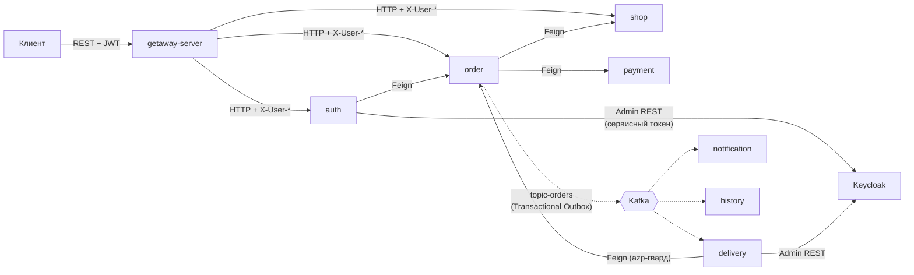

<details>
<summary>Порты и контейнеры (сводная таблица по docker-compose.yml)</summary>

| Компонент | Контейнер | Порт на хосте | Хранилище / примечание |
|-----------|-----------|---------------|------------------------|
| getaway-server | getaway-server | **8072** | Единый вход API + Swagger UI |
| Keycloak | keycloak | **8080** | realm `microservices-realm`, БД в postgres :5432 |
| config-server | config-server | 8071 | Конфигурации из config-repo (GitHub) |
| eureka-server | eureka-server | 8761 | Реестр инстансов |
| order-service | order-service | 8180 | PostgreSQL `OrderServiceDB` (postgres-order :5433) |
| shop-service | shop-service | 8181 | PostgreSQL `ShopServiceDB` (postgres-shop :5434) + Redis (кэш) |
| payment-service | payment-service | 8182 | PostgreSQL `PaymentServiceDB` (postgres-payment :5435) |
| notification-service | notification-service | 8183 | Без БД; Redis — дедупликация событий |
| history-service | history-service | 8184 | MongoDB `HistoryServiceDB` (mongo :27017) |
| auth-service | auth-service | 8185 | Без БД (все пользователи в Keycloak) |
| delivery-service | delivery-service | 8186 | PostgreSQL `DeliveryServiceDB` (postgres-delivery :5436) |
| Kafka | kafka | 9092 (хост) / 29092 (внутри сети) | topic-orders, topic-orders.DLT |
| Redis | redis | 6379 | Кэш shop, rate limit gateway, дедупликация notification |
| MongoDB | mongo / mongo-express | 27017 / 8081 | История заказов и веб-интерфейс к ней |
| pgAdmin | pgadmin | 5050 | Веб-UI для всех PostgreSQL |
| Kafdrop | kafdrop | 9000 | Веб-UI для Kafka (топики, сообщения, DLT) |
| Zipkin | zipkin | 9411 | Трассировки |
| Prometheus / Grafana | prometheus / grafana | 9090 / 3000 | Метрики и дашборды (Grafana: admin/admin) |
| Elasticsearch / Logstash / Kibana | elasticsearch / logstash / kibana | 9180 / 5000 / 5601 | Логи (Kibana: индекс app-logs-*) |
| Jenkins | — (ставится на хост) | 8888 | CI/CD: сборка, тесты, пуш образов в DockerHub |

---
</details>

## Быстрый старт: запуск всего проекта через Docker Compose

Весь стек (10 сервисов + Keycloak + Kafka + 4 PostgreSQL + MongoDB + Redis + мониторинг + логи) поднимается одной командой.

### Предварительные требования

- **Docker Desktop** (Windows с WSL2) или **Docker Engine + compose plugin** (Linux/macOS) — запущен;
- **8+ ГБ RAM** свободно для стека (ELK и Kafka требовательны);
- свободные порты из таблицы выше (особенно 8072, 8080, 5432–5436, 9092);
- конфигурации сервисов pulling-ся config-server'ом из публичного репозитория [config-repo](https://github.com/Sergistan/config-repo) — доступ token'ами настраивать не нужно.

### Шаг 1 — файл `.env`

В корне проекта создайте `.env` (шаблон — [.env.example](.env.example)):

```dotenv
ENCRYPT_KEY=<симметричный ключ шифрования>
```

Этим ключом config-server расшифровывает секреты вида `{cipher}...` из config-repo. Зашифрованы только креды SMTP-почты (Яндекс) для notification-service, а ключ шифрования симметричный — он есть только у владельца репозитория. Отсюда два сценария запуска:

| Сценарий | Что работает |
|----------|--------------|
| **Без `.env` / с произвольным ключом** | 9 сервисов работают полностью: регистрация, заказы, оплата, возврат, доставка, история. **notification-service будет перезапускаться (`Restarting`), письма на email не отправляются** — это ожидаемо, остальные сервисы от него не зависят (события Kafka никуда не теряются) |
| **С ключом владельца** | Всё выше **+ отправка писем** о статусах заказов на email покупателя |

Если вам нужны письма — свяжитесь с владельцем репозитория для получения ключа. Если письма не нужны — шаг 1 можно пропустить вовсе и просто игнорировать падающий notification-контейнер. Файл `.env` игнорируется git и не покидает вашу машину.

### Шаг 2 — запуск

```bash
docker compose up -d
```

При первом запуске Docker соберёт образы всех сервисов (Gradle bootJar внутри Dockerfile) и скачает образы инфраструктуры — это может занять 10–20 минут. Повторные запуски — 2–4 минуты.

### Шаг 3 — дождаться готовности

```bash
docker compose ps
```

Все контейнеры должны перейти в `healthy`/`running`. Дольше всех стартуют keycloak (start_period 60с) и elasticsearch. Быстрая проверка ключевых точек:

```bash
curl http://localhost:8072/actuator/health   # gateway отвечает
curl http://localhost:8761                   # Eureka: все 8 приложений UP
```

### Шаг 4 — убедиться, что всё работает

Пройдите сценарий из раздела [«Пошаговый сценарий тестирования через Swagger»](#пошаговый-сценарий-тестирования-через-swagger): логин `sergistan` / `111` → товар → заказ → оплата картой `5078 6038 0721 8893`. Через ~5 минут статус станет `DELIVERING`, ещё через ~2 — `DELIVERED` (письма — только с ключом владельца из Шага 1).

### Управление стеком

```bash
docker compose stop                      # остановить (данные в volume сохранятся)
docker compose up -d                     # запустить снова
docker compose logs -f order-service     # логи одного сервиса
docker compose up -d --build order-service  # пересобрать и перезапустить один сервис
docker compose down                      # убрать контейнеры (volume сохраняются)
docker compose down -v                   # СНОС С ДАННЫМИ: заказы/история/пользователи будут удалены!
```

<details>
<summary>Частые проблемы (troubleshooting)</summary>

| Симптом | Причина и решение |
|---------|-------------------|
| Все сервисы в `Restarting`/падают на старте | Смотреть `docker compose logs config-server`: нет доступа к config-repo или конфигурации не отдаются. Сервисы без конфигурации не стартуют — это ожидаемо |
| **Только notification-service** в `Restarting` | Нет `ENCRYPT_KEY` владельца (см. Шаг 1): SMTP-креды не расшифровываются. Ожидаемое поведение без ключа — письма отключены, остальные сервисы работают |
| Сервис стартует, но 401 на любой запрос | Ещё не готов Keycloak (до 60–90 с) — подождите и повторите логин в Swagger |
| `port is already allocated` | Один из портов занят локальными приложениями (часто 5432 — локальный PostgreSQL, 8080). Освободите порт или поменяйте маппинг слева в docker-compose.yml |
| После перезагрузки/сброса Docker Desktop контейнеров нет | Томa (данные) сохраняются, но контейнеры пересоздаются: снова `docker compose up -d`. Если образы сервисов потерялись — добавится `--build` |
| Kafka-события «не доходят» | Проверить консьюмеров: Kafdrop http://localhost:9000 (группы notification-group, history-group, delivery-group); заглянуть в topic `topic-orders.DLT` |

---
</details>

## Список микросервисов:

- **Config-server** (:8071) — централизованная конфигурация из config-repo;
- **Eureka-server** (:8761) — реестр инстансов (Service Discovery);
- **Getaway-server** (:8072) — единый вход API, проверка JWT, rate limiting;
- **Order-service** (:8180) — создание, оплата и возврат заказов;
- **Shop-service** (:8181) — каталог товаров и остатки;
- **Payment-service** (:8182) — платежи и возвраты средств;
- **Notification-service** (:8183) — письма о статусах заказов;
- **History-service** (:8184) — история заказов в MongoDB;
- **Auth-service** (:8185) — регистрация и удаление аккаунтов;
- **Delivery-service** (:8186) — доставка заказов курьерами.

### Подробно о каждом микросервисе

#### Config-server (:8071)
Инфраструктурный сервис централизованной конфигурации. При старте каждый сервис обращается сюда за своим `application.yml`-профилем; конфигурации живут в git-репозитории [config-repo](https://github.com/Sergistan/config-repo) — изменение настроек не требует пересборки образов. Секреты хранятся в зашифрованном виде (`{cipher}...`), ключ шифрования передаётся через переменную окружения `ENCRYPT_KEY` из локального `.env`.

#### Eureka-server (:8761)
Реестр инстансов (Service Discovery). Каждый сервис регистрируется и обновляет lease; Feign-клиенты и gateway находят адреса соседей по имени приложения — в конфигах нет ни одного захардкоженного URL соседних сервисов. Позволяет горизонтально масштабировать любой сервис (несколько инстансов = клиентская балансировка).

#### Getaway-server (:8072)
API-шлюз — единственная публичная точка входа. Проверяет подпись JWT по ключам Keycloak, применяет rate limiting на Redis (лимиты — в разделе «Безопасность»), а затем проксирует запрос в целевой сервис, добавляя доверенные заголовки `X-User-SubId/UserName/Email/Role` (перезаписывает — подделать извне нельзя). Также агрегирует Swagger UI всех сервисов и фильтрует, какие пути доступны снаружи (например, payment-api наружу не выставлен).

#### Order-service (:8180, PostgreSQL OrderServiceDB)
Сердце бизнес-логики: создание заказов (проверка и списание остатков через shop), оплата и возврат (через payment), хранение статусов с CAS-переходами. Именно здесь работает Transactional Outbox (таблица `outbox_events`), ReconciliationJob и публикация событий в Kafka. Хранит: заказы, позиции, адреса, пользователей (снапшот для писем/истории). Внутренние эндпоинты для delivery/auth защищены проверкой claim `azp`.

#### Shop-service (:8181, PostgreSQL ShopServiceDB + Redis)
Каталог товаров: CRUD для админа, постраничное получение с сортировкой для всех. Проверка остатков и идемпотентное списание/восстановление для order-service (маркеры в `stock_operations`). Кэширование чтений в Redis — «горячие» товары не бьют в PostgreSQL.

#### Payment-service (:8182, PostgreSQL PaymentServiceDB)
Платёжный шлюз учебного банка: счета/карты и операции. Оплата (PAYMENT) и возврат (REFUND) идемпотентны — уникальность `(order_uuid, type)`. По нему же сверяется ReconciliationJob при самовосстановлении заказов. Наружу через gateway не выставляется — только через order-service.

#### Notification-service (:8183, Redis)
Консьюмер `topic-orders`: по событиям финальных статусов отправляет письма через SMTP (JavaMailSender). Дедупликация по `eventId` (Redis SETNX с TTL) — повторная доставка события не отправит письмо дважды. Сбой отправки → ретраи → `topic-orders.DLT`.

#### History-service (:8184, MongoDB)
Консьюмер `topic-orders`: накапливает историю всех статусов заказов по пользователям (коллекция `orderHistory`). Дедупликация по `eventId` через уникальный индекс MongoDB.

#### Auth-service (:8185, без БД)
Саморегистрация (покупатель USER / курьер COURIER) и удаление собственного аккаунта через Keycloak Admin REST API (сервисный токен `auth-service-client`). Перед удалением через Feign проверяет незавершённые заказы в order-service и активные доставки в delivery-service — удалить аккаунт «в разгаре» нельзя.

#### Delivery-service (:8186, PostgreSQL DeliveryDB)
Доставка оплаченных заказов: третий консьюмер `topic-orders` (SUCCESS → создать доставку, REFUNDED → отменить). `CourierSyncJob` каждые 5 минут синхронизирует справочник курьеров с Keycloak (роль COURIER). Конвейер: атомарное занятие курьера (CAS AVAILABLE→BUSY) → T+5 минут `DELIVERING` (внутренний вызов order-service, ФИО курьера уходит в письмо) → +2 минуты `DELIVERED`, курьер освобождается. Идемпотентность по маркерам `processed_events`.

## Основные технологии:

- Приложение разработано с использованием Spring Boot 3 и Java 21;
- Использован сборщик пакетов Gradle;
- Использованы sql-база данных PostgreSQL и nosql-база данных MongoDB;
- Использована система управления миграциями Liquibase;
- С помощью Swagger осуществляется отправка запросов через эндпоинты приложения;
- В order-service реализованы технологии Resilience4j (CircuitBreaker и Retry) тем самым минимизируется риск каскадных отказов и автоматически обрабатываются временные сбои;
- Регистрация, аутентификация и авторизация пользователей происходит через OAuth 2.0 с помощью Keycloak;
- Использовался Redis в микросервисе shop-service для кеширования результатов запросов и снижения нагрузки на основную БД, а также в getaway-server для rate limiting запросов и в notification-service для дедупликации событий;
- Использован брокер сообщений Kafka для одновременной и асинхронной отправки сообщений на микросервисы notification-service для уведомления пользователя о состоянии заказа и history-service для сохранения состояний заказа. Надёжность обеспечена паттерном Transactional Outbox, ручным подтверждением смещений (ack-mode MANUAL_IMMEDIATE), дедупликацией событий и мёртвой очередью topic-orders.DLT;
- Использовалась библиотека MailSender для оповещения пользователей в notification-service;
- Взаимодействие между микросервисами order-service и shop-service, а также payment-service настроено через Feign Client с обнаружением инстансов через Eureka;
- Для запуска используются Dockerfile и docker-compose;
- Код покрыт 323 тестами: unit (JUnit 5, Mockito, WebMvcTest, DataJpaTest) и интеграционными с Testcontainers (PostgreSQL, Kafka, MongoDB) — подробно в разделе «Тестирование»;
- Для отслеживания трассировки запросов через микросервисы настроен Zipkin;
- Для сбора и хранения метрик, а также визуализации этих метрик в микросервисах использованы Prometheus и Grafana;
- Для сбора, хранения и визуализации логов и событий в микросервисах использованы Elasticsearch, Logstash и Kibana;
- Для сборки, тестирования сервисов, создания и пуша образов этих сервисов в DockerHub в среде Jenkins используется Jenkinsfile.

## Примеры API-запросов и ответов

Все запросы идут через getaway-server (`http://localhost:8072`) с заголовком `Authorization: Bearer <access_token>`.
Исключение — получение самого токена (это делает Keycloak напрямую) и анонимная регистрация.
Ниже — реальные примеры «живого» стенда; тестовые карты: `5078 6038 0721 8893` и `4696 9676 0740 8441` (на обеих есть средства).

### 1. Получение access-токена (Keycloak, password grant)

```bash
curl -X POST "http://localhost:8080/realms/microservices-realm/protocol/openid-connect/token" \
  -d "grant_type=password" \
  -d "client_id=spring-microservices" \
  -d "client_secret=apIkjKljSVdsDtzUknhm8AKIFECM2AfX" \
  -d "username=sergistan" -d "password=111"
```

<details>
<summary>Ответ 200 (сокращено)</summary>

```json
{
  "access_token": "eyJhbGciOiJSUzI1NiIsInR5cCIgIkpXVCJ9.eyJleHAiOjE3Mzg0NTQ0MDAsImlzcyI6Imh0dHA6Ly9sb2NhbGhvc3Q6ODA3Mi9yZWFsbXMvbWljcm9zZXJ2aWNlcy1yZWFsbSIsInN1YiI6IjdiMTBhNDA0LTU4ZmMtNGQyNS1iZjRkLWJhMWRjNzI1YjZmZiIsImF6cCI6InNwcmluZy1taWNyb3NlcnZpY2VzIiwicmVhbG1fYWNjZXNzIjp7InJvbGVzIjpbIkFETUlOIiwidXNlcl19fQ.xxxxx",
  "expires_in": 300,
  "refresh_token": "eyJhbGciOi...",
  "token_type": "Bearer"
}
```

`sub` — уникальный идентификатор пользователя (именно он проксируется гейтвеем в `X-User-SubId`), `azp` — клиент, роли — в `realm_access.roles`. Токен живёт 5 минут.
</details>

### 2. Auth-service

**Регистрация (анонимно):**

```bash
curl -X POST "http://localhost:8072/auth/api/v1/users" \
  -H "Content-Type: application/json" \
  -d '{"username":"ivanov","email":"ivanov@mail.ru","firstName":"Иван","lastName":"Иванов","password":"Str0ngPass!","role":"USER"}'
```

Ответ **201** — можно логиниться (см. шаг 1). Ошибки: **400** — невалидные поля; **409** — username/email занят; **503** — Keycloak недоступен.

**«Кто я» (перед удалением аккаунта):**

```bash
curl "http://localhost:8072/auth/api/v1/users/me" -H "Authorization: Bearer $TOKEN"
```

<details>
<summary>Ответ 200 (реальный курьер)</summary>

```json
{
  "sub": "7e97c7ef-90fd-4ac8-92f8-0da79223e22c",
  "username": "courier1",
  "firstName": "Mikhail",
  "lastName": "Kurierov",
  "email": "courier1@delivery.local",
  "role": "COURIER"
}
```
</details>

**Удаление своего аккаунта:**

```bash
curl -X DELETE "http://localhost:8072/auth/api/v1/users/me" -H "Authorization: Bearer $TOKEN"
```

Ответы: **204** — удалён из Keycloak; **400** с телом (реальный ответ стенда):

```json
{"messageError": "Нельзя удалить аккаунт: есть активные доставки"}
```

### 3. Shop-service — каталог товаров

**Список товаров (любой пользователь, постранично):**

```bash
curl "http://localhost:8072/shop/api/v1/products?page=0&size=2" -H "Authorization: Bearer $TOKEN"
```

<details>
<summary>Ответ 200 (сокращено)</summary>

```json
{
  "content": [
    {"articleId": "3873f81b-6d10-4860-97f4-0719eb88afaa", "name": "Смартфон Flagship X", "quantity": 14, "price": 65999.99},
    {"articleId": "e7c5f58f-691a-4f2b-85b3-61ba9413ff9d", "name": "Ноутбук Pro 15", "quantity": 7, "price": 10000.00}
  ],
  "totalElements": 8,
  "totalPages": 4,
  "number": 0,
  "size": 2
}
```
</details>

**Создание товара (только ADMIN):**

```bash
curl -X POST "http://localhost:8072/shop/api/v1/products" \
  -H "Authorization: Bearer $ADMIN_TOKEN" -H "Content-Type: application/json" \
  -d '{"name":"Наушники ANC","description":"Беспроводные, с шумоподавлением","quantity":50,"price":12999.00}'
```

Ответ **201** — созданный `ProductDto` (те же поля + `articleId`). Изменение — `PUT /shop/api/v1/products/{articleId}`, удаление — `DELETE /shop/api/v1/products/{articleId}` (тоже ADMIN).

### 4. Order-service — создание и просмотр заказа

```bash
curl -X POST "http://localhost:8072/order/api/v1/orders" \
  -H "Authorization: Bearer $TOKEN" -H "Content-Type: application/json" \
  -d '{"orderRequests":[{"articleId":"3873f81b-6d10-4860-97f4-0719eb88afaa","quantity":1}],
       "addressDto":{"city":"Los Angeles","street":"33th Avenue","houseNumber":233,"apartmentNumber":112}}'
```

<details>
<summary>Ответ 201 — OrderDto (реальный ответ стенда)</summary>

```json
{
  "orderUuid": "ac2e5f55-16a1-4364-b799-6333aa872076",
  "totalAmount": 65999.99,
  "orderStatus": "WAITING_FOR_PAYMENT",
  "createdAt": "2026-11-20 18:24",
  "addressDto": {"city": "Los Angeles", "street": "33th Avenue", "houseNumber": 233, "apartmentNumber": 112},
  "userDto": {"username": "sergistan", "firstName": "Сергей", "lastName": "Уточкин", "email": "dzaga73i98@gmail.com"},
  "orderRequests": {"articleId": "3873f81b-6d10-4860-97f4-0719eb88afaa", "quantity": 1}
}
```
</details>

Если товара нет/не хватает остатка — **400** `{"messageError": "Товар отсутствует в магазине или его количество недостаточно"}` (заказ не создаётся).

**Просмотр:** `GET /order/api/v1/orders/{orderUuid}` — OrderDto с текущим статусом (только владелец, иначе **403**); `GET /order/api/v1/orders` — все заказы текущего пользователя.

### 5. Оплата и возврат

**Оплата:**

```bash
curl -X POST "http://localhost:8072/order/api/v1/orders/ac2e5f55-16a1-4364-b799-6333aa872076/payments" \
  -H "Authorization: Bearer $TOKEN" -H "Content-Type: application/json" \
  -d '{"cardNumber":"5078 6038 0721 8893"}'
```

<details>
<summary>Ответ 200</summary>

```json
{"paymentId": "0f44b542-92e4-488c-8a72-573c7cad679a", "status": "SUCCESS"}
```
</details>

Нехватка средств — **402**, заказ переведётся в `FAILED`, списанные остатки вернутся в магазин. Повторный POST той же оплаты идемпотентен — вернётся уже созданный платёж.

**Возврат (в 5-минутном окне после оплаты, до старта доставки):**

```bash
curl -X POST "http://localhost:8072/order/api/v1/orders/ac2e5f55-16a1-4364-b799-6333aa872076/refunds" \
  -H "Authorization: Bearer $TOKEN" -H "Content-Type: application/json" \
  -d '{"cardNumber":"5078 6038 0721 8893"}'
```

Ответ **200** — `Заказ успешно отменен` (статус `REFUNDED`, деньги и остатки возвращены). После начала доставки — **400**:

```json
{"messageError": "Заказ уже передан в доставку или доставлен — возврат невозможен!"}
```

### 6. Внутренние сервисные эндпоинты (не доступны через gateway)

Вызываются только микросервисами между собой, защита — claim `azp` (кто выдал себя за клиента): order `POST/PATCH /orders/{uuid}/deliveries` (только delivery-service-client), order `GET /users/{subId}/has-active-orders` и delivery `GET /couriers/{subId}/active-deliveries-count` (только auth-service-client). Примеры запросов/ответов — в разделе «Доставка заказа».

### 7. Типовые ошибки

| HTTP | Когда | Тело |
|------|-------|------|
| 401 | Нет/просрочен токен | — |
| 402 | Недостаточно средств на карте | описание причины |
| 403 | Чужой заказ (IDOR-защита), не ADMIN для CRUD товаров | описание |
| 404 | Заказ/товар не найден | описание |
| 409 | username/email занят при регистрации | описание |
| 400 | Невалидные поля, нет товара, возврат вне окна, удаление с активными заказами/доставками | `{"messageError": "..."}` |
| 429 | Превышен rate limit (10/с — API, 5/20 — регистрация) | — |

## Надёжность и новые возможности:

Раздел описывает архитектурные улучшения, закрывающие гонки (race conditions), повышающие отказоустойчивость и безопасность системы.

### Устранение гонок и согласованность данных

- **CAS-переводы статусов заказа**: смена статуса выполняется атомарным UPDATE с условием `WHERE order_status IN (разрешённые статусы)` — два конкурирующих запроса не смогут перевести заказ дважды, проигравший получает 0 строк и корректно завершается;
- **Transactional Outbox**: событие для Kafka записывается в таблицу `outbox_events` в той же транзакции, что и статус заказа — невозможна ситуация «заказ оплачен, а событие потерялось». Фоновый OutboxRelay забирает пачки событий запросом `FOR UPDATE SKIP LOCKED` (параллельные инстансы не конфликтуют) и доставляет их в Kafka;
- **Компенсационные откаты**: если возврат средств в payment завершился ошибкой, заказ откатывается из PROCESSING обратно в SUCCESS — заказ не «застревает» в промежуточном статусе;
- **Гонка «возврат vs доставка»**: и refund, и перевод в DELIVERING начинаются из SUCCESS и оба идут CAS-UPDATE в order-service — PostgreSQL отдаёт победу ровно одному; проигравший корректно разруливается (refunded → 400 «возврат невозможен», delivery → 409 → отмена доставки и освобождение курьера);
- **Атомарное назначение курьера**: занятие курьера и привязка его к доставке — два CAS (AVAILABLE→BUSY и SEARCHING_COURIER→ASSIGNED); два конкурирующих потока не займут одного курьера, а при отмене доставки курьер освобождается.

Идемпотентность платежей, списания остатков и обработки событий вынесена в отдельный подраздел «Механизмы идемпотентности» ниже.

### Самовосстановление (ReconciliationJob)

Фоновая задача order-service каждые 60 секунд находит заказы, зависшие в `STOCK_PENDING`/`PROCESSING` дольше 10 минут (например, после падения сервиса в середине операции), сверяется с payment-service по фактическим платежам и приводит заказ к корректному финальному статусу: финализирует SUCCESS/REFUNDED, повторяет списание остатков или откатывает в WAITING_FOR_PAYMENT.

### Безопасность

- **Защита от IDOR**: операции с заказом (оплата, возврат, просмотр) доступны только его владельцу — чужой пользователь получает 403, даже зная orderUuid;
- **Доверенные заголовки X-User-***: getaway-server после проверки подписи JWT сам проксывает в сервисы идентификацию пользователя (sub, username, email, роль) в заголовках — подделать их извне нельзя, gateway перезаписывает их своими значениями;
- **Сервисный токен (client_credentials)**: внутренние вызовы order-service к payment-service для фоновых задач получают собственный OAuth2-токен через ServiceTokenClient (с кэшем) — не нужно хранить пользовательский JWT в фоновых процессах;
- **Service-to-service авторизация (azp)**: внутренние эндпоинты order-service (`POST/PATCH /orders/{uuid}/deliveries`, `has-active-orders`) принимают только сервисные токены ожидаемых клиентов (delivery-service-client / auth-service-client) — проверяется claim azp; обычный пользователь их вызвать не может;
- **Rate limiting**: маршруты order/shop/payment на getaway-server защищены ограничителем запросов на базе Redis (10 запросов/с, всплеск до 20; ключ — пользователь из JWT или IP для анонимов). Публичная саморегистрация `POST /auth/api/v1/users` — с отдельным лимитом 5/20 (анонимы ключуются по IP).

### Kafka и Transactional Outbox

**Задача:** order-service должен сообщать notification-, history- и delivery-service об изменении статуса заказа. Прямая запись в Kafka из бизнес-транзакции ненадёжна — есть *проблема двойной записи*: БД и брокер не могут участвовать в одной транзакции, поэтому возможны либо «статус оплачен, а событие потерялось» (упали до отправки), либо «событие ушло, а коммит заказа откатился» (consumers узнают о несуществующем заказе).

**Решение — Transactional Outbox.** Как работает по шагам:

1. В бизнес-транзакции order-service атомарно пишет и новый статус заказа, и запись события в таблицу `outbox_events` (один COMMIT — они не разъедутся никогда);
2. Фоновый `OutboxRelay` (каждую секунду) выбирает пачку до 100 записей запросом `SELECT ... FOR UPDATE SKIP LOCKED` — параллельные инстансы сервиса не конфликтуют за одни и те же строки;
3. Запись отправляется в Kafka с ключом `orderUuid` (все события заказа попадают в одну партицию — порядок внутри заказа сохраняется) и уникальным `eventId`;
4. Только после подтверждения отправки запись удаляется из outbox; при сбое — останется и уйдёт в следующем такте (дубликаты на приёме отсекаются дедупликацией, см. ниже).

**Топики и группы потребителей:**

| Топик | Кто пишет | Кто читает (группа) | Назначение |
|-------|-----------|---------------------|------------|
| `topic-orders` | order-service (OutboxRelay) | notification-group, history-group, delivery-group | События SUCCESS / FAILED / REFUNDED / DELIVERING / DELIVERED |
| `topic-orders.DLT` | consumers (после исчерпания ретраев) | — (ручной разбор через Kafdrop) | Мёртвая очередь: сообщения, которые не удалось обработать |

Каждая группа читает топик независимо (у каждой свой offset): письмо, история и доставка не мешают друг другу.

**Гарантии на приёме:**

- Подтверждение смещений вручную (ack-mode MANUAL_IMMEDIATE) — offset двигается только после успешной обработки;
- **Дедупликация по `eventId`**: повторная доставка (at-least-once) не превратится в дубль — Redis SETNX с TTL в notification-service, уникальный индекс в MongoDB в history-service, маркер `processed_events` в PostgreSQL в delivery-service;
- **Ретраи и DLQ**: при сбое обработки (например, временный троттлинг SMTP) запись повторяется (по умолчанию 3 попытки с паузой 10 с), после чего переносится в `topic-orders.DLT` с заголовками причины — обработка остальных событий не блокируется.

Сквозной пример: оплата прошла → COMMIT (статус `SUCCESS` + строка outbox) → релей публикует событие с `eventId=21b7cbcf...` → notification проверяет eventId в Redis (новый — шлёт письмо), history — уникальный индекс Mongo (новый — дописывает статус), delivery — `processed_events` (новый — создаёт доставку). Если релей отправит событие дважды, все трое просто увидят знакомый eventId и пропустят дубль.

### Механизмы идемпотентности

**Идемпотентность** — свойство операции: повторное её выполнение с теми же входными данными не меняет результат (не списывает деньги дважды, не отправляет второе письмо). Зачем это здесь: сети ретраят запросы (Feign Retry), а Kafka гарантирует доставку *at-least-once* — дубликаты возможны всегда, и система обязана безопасно их переживать.

Где какой механизм работает (сводно):

| Механизм | Сервис | Ключ идемпотентности | Что при повторе |
|----------|--------|----------------------|-----------------|
| Уникальный платёж | payment-service | `UNIQUE(order_uuid, type)` в таблице платежей | Повторная оплата/возврат того же заказа вернёт уже созданный платёж — без второго списания |
| Маркеры списания остатков | shop-service | Запись в `stock_operations` на каждую операцию списания/восстановления | Повторная команда (ретрай после сбоя сети) увидит маркер и не изменит остаток второй раз |
| Дедупликация событий (письма) | notification-service | `eventId` → Redis SETNX + TTL | Знакомый eventId — письмо не отправляется |
| Дедупликация событий (история) | history-service | `eventId` → уникальный индекс MongoDB | Дубль статуса не допишется в историю |
| Дедупликация событий (доставка) | delivery-service | `eventId` → маркер в `processed_events` (PostgreSQL) | Доставка не создастся повторно; повтор `POST /deliveries` при DELIVERING/DELIVERED вернёт 200 без второго события |
| CAS-переходы статусов | order-service | `UPDATE ... WHERE order_status IN (разрешённые)` | Два конкурирующих запроса (возврат vs доставка) не пройдут оба — проигравший получит 0 строк и корректную ошибку |
| CAS-занятие курьера | delivery-service | `tryAssign`: `UPDATE ... WHERE status='AVAILABLE'` | Два потока не займут одного курьера — победит ровно один |

Пример разбора конфликта: покупатель жмёт «вернуть» за секунду до T+5, когда delivery-планировщик уже переводит заказ в `DELIVERING`. Оба начинают с `SUCCESS`, но CAS-UPDATE в PostgreSQL выполнит только первый; второй получит 0 строк — либо возврат 400 «возврат невозможен» (если успел delivery), либо доставка отменится с кодом 409 и курьер освободится (если успел возврат). Двойного исхода не бывает.

### Инфраструктура

- Feign-клиенты находят сервисы через Eureka (без хардкода URL);
- Секреты не хранятся в git: ключ шифрования config-server передаётся через переменную окружения из локального `.env` (шаблон — `.env.example`), зашифрованные креды (`{cipher}...`) — в config-repo;
- Grafana при старте автоматически получает datasource Prometheus и дашборды JVM (Micrometer) и Spring Boot Statistics из каталога `grafana/provisioning` (версонируются в git);
- Ошибки запросов возвращают понятные 400-ответы с указанием проблемного поля (например, некорректный формат articleId) вместо стандартных заглушек Spring.

### Документация кода

Все классы, методы и репозитории покрыты javadoc на русском языке (назначение, гарантии целостности, потоки данных), пакеты `web`/`feign`/`dto` имеют `package-info.java` с описанием, какие данные и куда текут.

## Тестирование: Unit и Integration тесты

Проект покрыт **323 тестами**: 225 unit + 98 интеграционных.

### Инструменты по типам тестов

| Тип | Инструменты | Что проверяет |
|-----|-------------|---------------|
| Unit (сервисы, джобы, клиенты) | JUnit 5 + Mockito | Бизнес-логика в изоляции: моки репозиториев/Feign/Kafka, все ветки условий и ошибок |
| Контроллеры | `@WebMvcTest` + MockMvc | Контракты REST: коды ответов, JSON-тела, безопасности-правила (в т.ч. `jwt()` post-processor с клеймом `azp` для внутренних эндпоинтов) |
| Репозитории | `@DataJpaTest` + **Testcontainers (PostgreSQL)** | Реальные SQL: CAS-переходы, уникальные ограничения, конкурентный доступ |
| Сквозные | `@SpringBootTest` + **Testcontainers (Kafka, PostgreSQL, MongoDB)** | Полный контекст: отправка в Kafka c заголовком `__TypeId__`, работа кэша, идемпотентность платежей, DLT |

Интеграционные тесты поднимают настоящие контейнеры — **Docker должен быть запущен** (на CI — docker-агент Jenkins).

### Распределение по модулям

| Модуль | Unit | Integration | Всего | Ключевое покрытие |
|--------|------|-------------|-------|-------------------|
| order-service | 76 | 32 | 108 | CAS-статусы, окно возврата, компенсации, outbox, внутренние эндпоинты (azp), Resilience4j (CircuitBreaker/Retry), ReconciliationJob |
| shop-service | 40 | 26 | 66 | CRUD + кэш Redis (реальный Testcontainers), идемпотентные остатки |
| payment-service | 21 | 23 | 44 | Оплата/возврат, идемпотентность `(order_uuid, type)` |
| auth-service | 27 | — | 27 | Регистрация/удаление, проверки активных заказов и доставок, GET /users/me |
| delivery-service | 20 | 9 | 29 | Конвейер доставки, конкурентный `tryAssign`, DLT-сценарий, azp-гвард |
| getaway-server | 13 | — | 13 | Маршруты, анонимная регистрация, перезапись X-User-* |
| notification-service | 17 | 5 | 22 | Формирование писем, дедупликация, DLT |
| history-service | 7 | 3 | 10 | Сохранение статусов, дедупликация по eventId |
| config-server, eureka-server | 4 | — | 4 | Контекст запускается |

### Примеры того, что проверяется (реальные сценарии)

**Unit — гонка «возврат vs доставка»** (`OrderServiceTest`): `refundedOrder_delivering_or_delivered_rejected` убеждается, что возврат из `DELIVERING`/`DELIVERED` даёт 400, а `markOrderDelivering_conflictAfterRefund` — что при конфликте с возвратом доставка не меняет заказ повторно.

**Integration — конкурентное занятие курьера** (`CourierRepositoryTest`, реальный PostgreSQL): два потока дергают CAS-метод

```java
@Modifying(clearAutomatically = true, flushAutomatically = true)
@Query("UPDATE Courier c SET c.status = 'BUSY', c.updatedAt = CURRENT_TIMESTAMP " +
        "WHERE c.id = :id AND c.status = 'AVAILABLE'")
int tryAssign(@Param("id") Long id);
```

и тест проверяет, что ровно один получил `1`, а второй — `0` (курьер не будет занят дважды).

**Integration — идемпотентность платежей** (`PaymentIdempotencyIntegrationTest`): две одинаковые оплаты одного заказа возвращают один и тот же `paymentId` — второе списание не создаётся.

**Integration — DLT** (`NotificationDltIntegrationTest`): при падении обработки после ретраев сообщение попадает в `topic-orders.DLT`, а консьюмер продолжает обрабатывать следующие.

### Как запускать

```bash
.\gradlew.bat test                    # все 10 модулей (Windows)
./gradlew test                        # Linux/macOS
.\gradlew.bat :delivery-service:test  # один модуль
```

Отчёты (по каждому тесту — успех/ошибка/время): `<модуль>/build/reports/tests/test/index.html`. Без запущенного Docker интеграционные тесты будут пропущены с ошибкой Testcontainers — unit-тесты отработают.

## Настройка стартовых пользователей в Keycloak:
В системе зарегистрированы 2 стартовых пользователя:  

**USERNAME:** sergistan **PASSWORD:** 111 (ADMIN)

**USERNAME:** umami **PASSWORD:** 222 (USER)

А также 3 стартовых курьера (client role COURIER, регистрируются через auth-service или создаются в админке):  

**USERNAME:** courier1 (Mikhail) **PASSWORD:** 111 · **USERNAME:** courier2 (Ivan) **PASSWORD:** 222 · **USERNAME:** courier3 (Dmitry) **PASSWORD:** 333

Для работы auth-service и delivery-service в realm дополнительно настроены (одноразово, вручную):
- client role **COURIER** у клиента spring-microservices;
- сервисные клиенты **auth-service-client** (realm-management: manage-users, view-users, view-clients) и **delivery-service-client** (view-users, view-clients) с включёнными Service accounts;
- роль USER или COURIER назначается автоматически при саморегистрации `POST /auth/api/v1/users`.

### Общая настройка Keycloak:


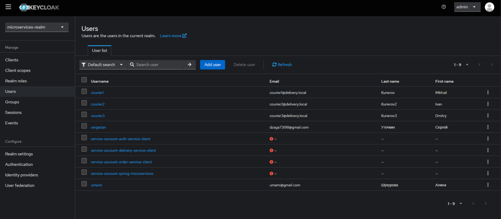
Настройка spring-microservices аналогична настройкам в auth-service-client и delivery-service-client
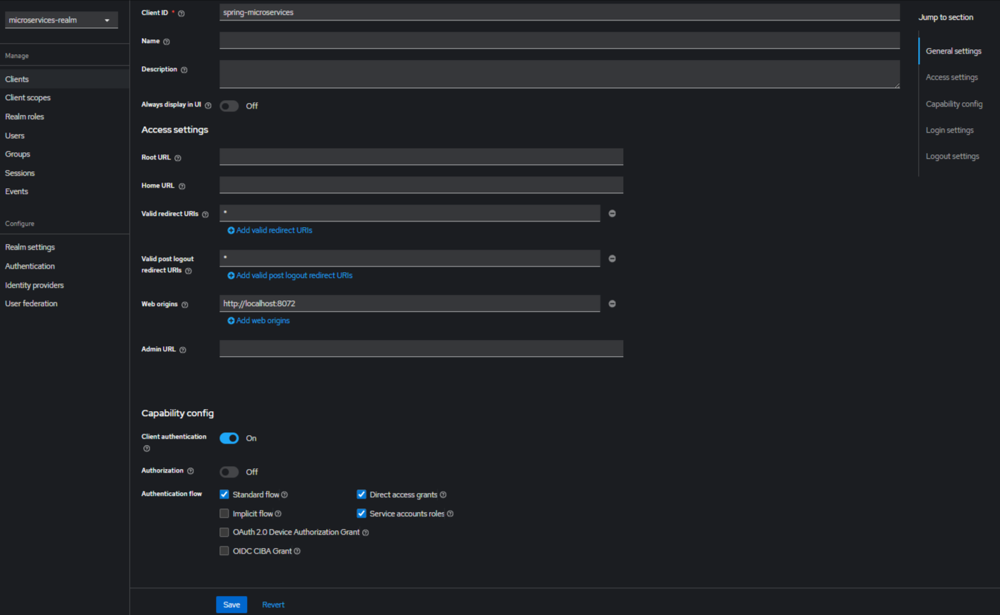


## Auth-service, Order-service API и Shop-service API в Swagger:

Эндпоинты для создания, оплаты, возврата заказов, добавления, изменения, удаления и получения товара/товаров,
саморегистрации пользователя/курьера и удаления аккаунта,
а также кнопка аутентификации посредством OAuth 2.0 с помощью Keycloak представлены в Swagger.

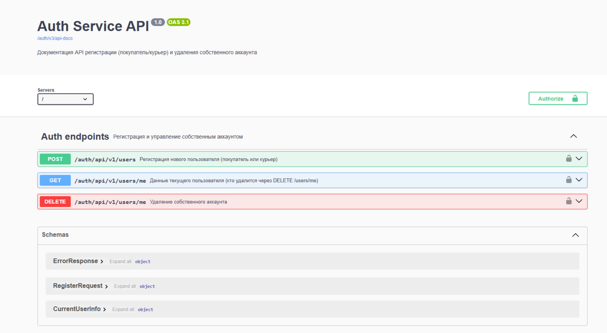


### Пошаговый сценарий тестирования через Swagger

Полный «покупательский» цикл без единой команды в терминале:

1. **Открыть**: http://localhost:8072/swagger-ui.html — в правом верхнем углу выпадающий список групп: auth-service / order-service / shop-service API;
2. **Авторизоваться**: кнопка **Authorize** → OAuth2 (`spring-microservices` уже подставлен) → логин `sergistan` / `111` → Authorize. Swagger сохранит токен и будет подписывать все запросы сам (токен живёт 5 минут — по истечении просто повторно нажмите Authorize);
3. **Взять товар** (группа shop-service): `GET /shop/api/v1/products` → Try it out → Execute → скопируйте `articleId` из ответа;
4. **Создать заказ** (группа order-service): `POST /order/api/v1/orders` → Try it out → вставьте свой `articleId`, укажите количество и адрес → Execute → **201**, в ответе `orderUuid` и статус `WAITING_FOR_PAYMENT`;
5. **Оплатить**: `POST /order/api/v1/orders/{orderUuid}/payments` → вставьте `orderUuid` и карту `5078 6038 0721 8893` → Execute → **200** `{"status":"SUCCESS"}`;
6. **Наблюдать доставку**: `GET /order/api/v1/orders/{orderUuid}` — через ~5 минут статус сменится на `DELIVERING` (на email придёт письмо с ФИО курьера), ещё через ~2 минуты — `DELIVERED`;
7. **Проверить возврат** (на новом заказе): сразу после оплаты `POST /order/api/v1/orders/{orderUuid}/refunds` → 200 «Заказ успешно отменен»; повторный возврат или возврат доставленного заказа → 400 с причиной.

Типичные ситуации: **401** — истёк токен (повторите шаг 2); **429** — превысили rate limit (подождите секунду); **403** — пытаетесь открыть чужой orderUuid.

## Основной алгоритм работы проекта:

### Жизненный цикл заказа по шагам (с таймингами)

| Момент | Действие | Кто выполняет | Статус заказа | Что видит клиент |
|--------|----------|---------------|---------------|------------------|
| T+0 | Создание заказа: проверка остатков (Feign→shop), расчёт цены, списание остатков, запись заказа | order-service | `WAITING_FOR_PAYMENT` (после краткого `STOCK_PENDING`) | 201 + OrderDto |
| T+0…∞ | Оплата картой: CAS-захват в `PROCESSING`, вызов payment, один COMMIT — статус `SUCCESS` + событие в outbox | order-service ← payment-service | `PROCESSING` → `SUCCESS` | 200 `{"paymentId","status":"SUCCESS"}` |
| сразу после оплаты | Событие SUCCESS → Kafka → письмо «заказ оплачен» + запись в историю + создание доставки и занятие курьера | notification, history, delivery (параллельно) | — (без изменений) | письмо на email |
| T+0…T+5 мин | **Окно возврата**: `POST /orders/{uuid}/refunds` — CAS `SUCCESS→PROCESSING`, возврат средств, восстановление остатков | order-service ← payment-service | `REFUNDED` | 200 «Заказ успешно отменен» |
| T+5 мин | Планировщик доставки: внутренний `POST /orders/{uuid}/deliveries` с ФИО курьера — CAS `SUCCESS→DELIVERING` | delivery-service → order-service | `DELIVERING` | письмо «Ваш курьер: {ФИО}»; возврат больше невозможен (400) |
| T+5+2 мин | Завершение: `PATCH /orders/{uuid}/deliveries` — CAS `DELIVERING→DELIVERED`, событие, курьер освобождён | delivery-service → order-service | `DELIVERED` (финальный) | статус в GET заказа (письмо не дублируется) |

Ветвления: товара нет → 400 на создании (заказа не существует); не хватает средств → **402**, заказ `FAILED`, остатки возвращены; платёж «завис» между статусами → ReconciliationJob через 10 минут приведёт к факту (см. схему 6 ниже). Подробные JSON каждого шага — в следующих подразделах и в разделе «Примеры API-запросов и ответов»; наглядные sequence-диаграммы всех сценариев — в разделе «Схемы взаимодействия сервисов».

### Регистрация пользователя (Auth-service)

Новый покупатель или курьер регистрируется анонимно по /auth/api/v1/users (эндпоинт защищён отдельным rate-limiter 5/20 — анонимы ключуются по IP):

<details>
<summary>RegisterRequest</summary>

```json
{
  "username": "ivanov",
  "email": "ivanov@mail.ru",
  "firstName": "Иван",
  "lastName": "Иванов",
  "password": "Str0ngPass!",
  "role": "USER"
}
```
</details>

<details>
<summary>Описание полей в RegisterRequest</summary>

| Поле | Тип | Описание |
|------|-----|----------|
| `username` | `string` | Логин, 3–50 символов (латиница/цифры/`._-`), уникальный в realm |
| `email` | `string` | Электронная почта, уникальная в realm |
| `firstName` | `string` | Имя |
| `lastName` | `string` | Фамилия |
| `password` | `string` | Пароль, от 8 до 128 символов |
| `role` | `string` | Роль при регистрации: `USER` (покупатель) или `COURIER` (курьер). Зарегистрироваться как ADMIN нельзя |

---
</details>

Auth-service вызывает Keycloak Admin REST (сервисный токен auth-service-client): `POST /users` (создание с паролем) и назначение
client role USER/COURIER. Ответы: **201** — можно логиниться; **400** — ошибка валидации полей; **409** — username/email уже занят;
**503** — Keycloak недоступен. Курьеры попадают в справочник delivery-service при ближайшей синхронизации (раз в 5 минут).

### Удаление собственного аккаунта (Auth-service)

Удаление выполняется по /auth/api/v1/users/me (JWT; идентификация — доверенный заголовок X-User-SubId от гейтвея).
Перед удалением можно вызвать `GET /auth/api/v1/users/me` — «кто я»: возвращает данные текущего залогиненного
пользователя (sub, логин, ФИО, email, роль), чтобы убедиться, чей именно аккаунт будет удалён.
Перед удалением auth-service через Feign спрашивает order-service: `GET /order/api/v1/users/{subId}/has-active-orders`
(сервисный токен, azp-гвард) и delivery-service: `GET /delivery/api/v1/couriers/{subId}/active-deliveries-count`
(для курьеров — нельзя удалиться «в разгаре» доставки). Ответы: **204** — пользователь удалён из Keycloak; **400** — есть незавершённые заказы или активные доставки
(активными считаются и неоплаченные, и SUCCESS — после оплаты предстоит доставка); **404** — пользователя нет; **503** —
не удалось проверить заказы/доставки (сервис недоступен — удалять «вслепую» отказано). Завершённые заказы и история в Mongo сохраняются.

### Создание заказа:
Клиент создает заказ для покупки товара по /order/api/v1/orders и отправляет запрос:

<details>
<summary>CompositeRequest</summary>

```json
{
  "orderRequests": [
    {
      "articleId": "3873f81b-6d10-4860-97f4-0719eb88afaa",
      "quantity": 1
    }
  ],
  "addressDto": {
    "city": "Los Angeles",
    "street": "33th Avenue",
    "houseNumber": 233,
    "apartmentNumber": 112
  }
}
```
</details>

<details>
<summary>Описание полей в CompositeRequest</summary>

| Поле | Тип | Описание |
|------|-----|----------|
| `articleId` | `UUID` (string) | Идентификатор товара |
| `quantity` | `integer` | Количество товара |
| `city` | `string` | Город |
| `street` | `string` | Улица |
| `houseNumber` | `integer` | Номер дома |
| `apartmentNumber` | `integer` | Номер квартиры|
---
</details>

Затем через FeignClient OrderService обращается к ShopService, чтобы удостовериться, что такой товар по id есть в бд магазина 
и его количество в бд позволяет создать такой заказ. Если все условия соблюдены заказ создается 
(OrderService обращается к ShopService через FeignClient для подсчета итоговой стоимости заказа) возвращается 201 с ответом:

<details>
<summary>OrderDto</summary>

```json
{
  "orderUuid": "3f9edc4b-e4cf-4257-a485-72a147a0b45f",
  "totalAmount": 1000,
  "orderStatus": "WAITING_FOR_PAYMENT",
  "createdAt": "2025-01-12 13:56",
  "addressDto": {
    "city": "Los Angeles",
    "street": "33th Avenue",
    "houseNumber": 233,
    "apartmentNumber": 112
  },
  "userDto": {
    "username": "sergistan",
    "firstName": "Сергей",
    "lastName": "Уточкин",
    "email": "dzaga73i98@gmail.com"
  },
  "orderRequests": {
    "articleId": "3873f81b-6d10-4860-97f4-0719eb88afaa",
    "quantity": 1
  }
}
```
</details>

<details>
<summary>Описание полей в OrderDto</summary>

| Поле | Тип                         | Описание |
|------|-----------------------------|----------|
| `orderUuid` | `UUID` (string)             | Уникальный идентификатор заказа |
| `totalAmount` | `double`                    | Общая сумма заказа |
| `orderStatus` | `string`                    | Статус заказа (см. «Возможные статусы заказа») |
| `createdAt` | `string (yyyy-MM-dd HH:mm)` | Дата и время создания заказа |
| `city` | `string`                    | Город доставки |
| `street` | `string`                    | Улица доставки |
| `houseNumber` | `integer`                   | Номер дома |
| `apartmentNumber` | `integer`                   | Номер квартиры (опционально) |
| `username` | `string`                    | Логин пользователя |
| `firstName` | `string`                    | Имя пользователя |
| `lastName` | `string`                    | Фамилия пользователя |
| `email` | `string`                    | Электронная почта пользователя |
| `articleId` | `UUID` (string)             | Идентификатор товара в заказе |
| `quantity` | `integer`                   | Количество товара в заказе |

</details>

<details>
<summary>Возможные статусы заказа</summary>

| Статус | Значение |
|--------|----------|
| `STOCK_PENDING` | Заказ создаётся, остатки товаров ещё не списаны |
| `WAITING_FOR_PAYMENT` | Остатки списаны, заказ ожидает оплаты клиентом |
| `PROCESSING` | Идёт операция (оплата или возврат средств) — промежуточный захват статуса |
| `SUCCESS` | Заказ успешно оплачен (действует 5-минутное окно возврата) |
| `FAILED` | Заказ не выполнен (нет товара/остатков, не прошла оплата или списание) |
| `REFUNDED` | Оплаченный заказ отменён до начала доставки, средства и остатки возвращены |
| `DELIVERING` | Прошло 5 минут с оплаты: курьер принял заказ, возврат уже невозможен |
| `DELIVERED` | Заказ вручён покупателю — финальный статус |

Смена статусов выполняется атомарными CAS-переходами: заказ переходит из статуса в статус только из разрешённых предыдущих статусов, что исключает рассинхронизацию при конкурентных запросах.

</details>

После создания заказа в бд магазина уменьшается количество товара на количество указанное в заказе даже если заказ еще не оплачен, чтобы не было проблем 
с одновременным созданием заказов с одинаковыми товарами разными пользователями. Списание остатков идемпотентно: каждая операция фиксируется 
маркером в таблице stock_operations, поэтому повторная доставка команды (после сбоя сети или ретрая) не спишет товар дважды.

### Оплата заказа:
Оплата заказа осуществляется по /order/api/v1/orders/{orderUuid}/payments и отправляется запрос через FeignClient на PaymentService:

<details>
<summary>PaymentRequest</summary>

```json
{
  "orderUuid": "3f9edc4b-e4cf-4257-a485-72a147a0b45f",
  "cardNumber": "5078 6038 0721 8893"
}
```
</details>

<details>
<summary>Описание полей в PaymentRequest</summary>

| Поле | Тип | Описание                                 |
|------|-----|------------------------------------------|
| `orderUuid` | `UUID` (string) | Уникальный идентификатор заказа          |
| `cardNumber` | `string` | Номер банковской карты для оплаты заказа |
---
</details>

В случае ввода корректной банковской карты и при условии необходимого количества денег на ней для оплаты заказа возвращается 200 
с ответом. Оплата идемпотентна: повторный запрос по тому же заказу не спишет средства дважды — платёж защищён уникальным 
ограничением `(order_uuid, type)` в базе payment-сервиса, повторный вызов вернёт уже созданный платёж:

<details>
<summary>PaymentRequest</summary>

```json
{
  "paymentId": "3f9edc4b-e4cf-4257-a485-72a147a0b45f",
  "status": "SUCCESS"
}
```
</details>

<details>
<summary>Описание полей в PaymentRequest</summary>

| Поле | Тип | Описание                                 |
|------|-----|------------------------------------------|
| `paymentId` | `UUID` (string) | Уникальный идентификатор оплаты заказа   |
| `status` | `string` | Статус платежа (см. «Возможные статусы заказа») |
---
</details>

Если денег на счету банковской карты недостаточно для оплаты заказа, то статус меняется на FAILED.
В любом случае если оплата прошла или не прошла - OrderDtoForKafka отправляется в очередь kafka для HistoryService и NotificationService:
<details>
<summary>OrderDtoForKafka</summary>

```json
{
  "orderUuid": "3f9edc4b-e4cf-4257-a485-72a147a0b45f",
  "totalAmount": 1000,
  "orderStatus": "SUCCESS",
  "createdAt": "2025-01-12 13:56",
  "updatedAt": "2025-01-12 13:57",
  "addressDto": {
    "city": "Los Angeles",
    "street": "33th Avenue",
    "houseNumber": 233,
    "apartmentNumber": 112
  },
  "userDto": {
    "username": "sergistan",
    "firstName": "Сергей",
    "lastName": "Уточкин",
    "email": "dzaga73i98@gmail.com"
  },
  "orderRequests": {
    "articleId": "3873f81b-6d10-4860-97f4-0719eb88afaa",
    "quantity": 1
  },
  "paymentId" : "3f9edc4b-e4cf-4257-a485-72a147a0b45f",
  "eventId" : "98b0743e-64fc-4629-952f-9e3412c8c79b"
}
```
</details>

<details>
<summary>Описание полей в OrderDto</summary>

| Поле | Тип                         | Описание                                       |
|------|-----------------------------|------------------------------------------------|
| `orderUuid` | `UUID` (string)             | Уникальный идентификатор заказа                |
| `totalAmount` | `double`                    | Общая сумма заказа                             |
| `orderStatus` | `string`                    | Статус заказа (см. «Возможные статусы заказа»)  |
| `createdAt` | `string (yyyy-MM-dd HH:mm)` | Дата и время создания заказа                   |
| `updatedAt` | `string (yyyy-MM-dd HH:mm)` | Дата и время обновления заказа                 |
| `city` | `string`                    | Город доставки                                 |
| `street` | `string`                    | Улица доставки                                 |
| `houseNumber` | `integer`                   | Номер дома                                     |
| `apartmentNumber` | `integer`                   | Номер квартиры (опционально)                   |
| `username` | `string`                    | Логин пользователя                             |
| `firstName` | `string`                    | Имя пользователя                               |
| `lastName` | `string`                    | Фамилия пользователя                           |
| `email` | `string`                    | Электронная почта пользователя                 |
| `articleId` | `UUID` (string)             | Идентификатор товара в заказе                  |
| `quantity` | `integer`                   | Количество товара в заказе                     |
| `paymentId` | `UUID` (string)             | Уникальный идентификатор оплаты заказа         |
| `eventId` | `UUID` (string)             | Идентификатор события — по нему потребители дедуплицируют доставку (at-least-once не превращается в дубликаты писем/записей) |

</details>

### Отмена заказа:
Заказ можно отменить лишь при условии, что он был до этого успешно оплачен. Отменить заказ может только его владелец — 
при попытке отмены чужого заказа (по известному orderUuid) возвращается 403. Отмена заказа осуществляется по /order/api/v1/orders/{orderUuid}/refunds и отправляется запрос через FeignClient на PaymentService:

<details>
<summary>PaymentRequest</summary>

```json
{
  "orderUuid": "3f9edc4b-e4cf-4257-a485-72a147a0b45f",
  "cardNumber": "5078 6038 0721 8893"
}
```
</details>

<details>
<summary>Описание полей в PaymentRequest</summary>

| Поле | Тип | Описание                                                        |
|------|-----|-----------------------------------------------------------------|
| `orderUuid` | `UUID` (string) | Уникальный идентификатор заказа                                 |
| `cardNumber` | `string` | Номер банковской карты для возврата средств после отмены заказа |
---
</details>

В случае ввода корректной банковской карты возвращается 200 с ответом "Заказ успешно отменен". Статус в заказе меняется на REFUNDED 
и OrderDtoForKafka отправляется в очередь kafka для HistoryService и NotificationService с измененными данными.

Перед возвратом средств заказ атомарно захватывается CAS-переходом `SUCCESS → PROCESSING` (защита от одновременных возвратов). 
Если возврат средств в payment-service завершился ошибкой, заказ автоматически откатывается из PROCESSING обратно в SUCCESS — 
заказ не «застревает» в промежуточном статусе, а клиент получает понятную ошибку с причиной (например, «оплаченный заказ не найден»).

После отмены заказа в бд магазина увеличивается количество товара на количество указанное в возвращенном заказе (идемпотентно, 
по маркеру в stock_operations), а сумма средств потраченных на оплату заказа возвращается на указанную карту.

**Окно возврата — 5 минут.** Возврат возможен только пока заказ в статусе `SUCCESS`. Через 5 минут после оплаты delivery-service
переводит заказ в `DELIVERING` (курьер принял заказ) — с этого момента и после вручения (`DELIVERED`) возврат невозможен:
клиент получает 400 «Заказ уже передан в доставку или доставлен — возврат невозможен!». Гонка «возврат в последнюю секунду
окна vs перевод в DELIVERING» разрешается атомарно на стороне order-service (CAS из SUCCESS выигрывает ровно один).

Операции по проверке, созданию, оплаты и возврата заказа выполнены с технологиями CircuitBreaker и Retry для повышения отказоустойчивости системы.

### Создание, изменение, удаление и получение товара/товаров в ShopService.
Создание, изменение, удаление и получение товара/товаров в ShopService реализованы классическими CRUD операциями. 
Единственное ограничение заключается в том, что создание, изменение и удаление товаров в магазине может осуществлять только админ.
Также над CRUD операциями установлено кэширование через Redis для повышения производительности системы.
Эндпоинт на получение всех товаров в магазине создан с применением возможности сортировки, ограничения выдачи постранично с указанием нужного размера страницы.

### NotificationService и HistoryService
Событие в формате OrderDtoForKafka отправляется в Kafka при изменении заказа на **финальный статус**:
- `SUCCESS` — заказ успешно оплачен;
- `FAILED` — оплата не прошла (например, недостаточно средств);
- `REFUNDED` — оплаченный заказ отменён (до начала доставки);
- `DELIVERED` — заказ вручён покупателю.

Стадия `DELIVERING` (курьер принял заказ) тоже публикуется событием — по нему NotificationService отправляет письмо
«Ваш заказ принят курьером и доставляется по адресу … Ваш курьер: {ФИО}. Заказ будет доставлен в течение дня.»
(ФИО передаёт delivery-service, при DELIVERED повторное письмо не отправляется).

Промежуточные состояния (`STOCK_PENDING`, `WAITING_FOR_PAYMENT`, `PROCESSING`) событиями не сопровождаются. 
Если товар недоступен на этапе создания, заказ не создаётся и событие не отправляется — клиент сразу получает 400 с причиной. 
В NotificationService с помощью JavaMailSender происходит отправка сообщений о статусе заказов через электронную почту пользователя.


В HistoryService происходит сохранение истории заказов (успешные, неуспешные и отмененные заказы) в MongoDB.


### Доставка заказа (Delivery-service)

После оплаты (событие SUCCESS в topic-orders) delivery-service создаёт доставку и атомарно занимает свободного курьера
(CAS AVAILABLE→BUSY). Через 5 минут после оплаты планировщик вызывает внутренний эндпоинт order-service:

<details>
<summary>POST /order/api/v1/orders/{orderUuid}/deliveries (внутренний, только delivery-service по azp)</summary>

Запрос (ФИО назначенного курьера — попадёт в письмо покупателю):

```json
{
  "courierName": "Ivan Kurierov"
}
```

Ответ 200:

```json
{
  "orderUuid": "3f9edc4b-e4cf-4257-a485-72a147a0b45f",
  "orderStatus": "DELIVERING"
}
```

Ответ **409** — заказ уже не в SUCCESS (покупатель успел вернуть): delivery отменяет доставку (CANCELLED) и освобождает курьера.
Повтор при DELIVERING/DELIVERED идемпотентен — 200 без второго события.
</details>

Завершение доставки (через delivery.timing.deliver-after-minutes, по умолчанию 2 минуты) — `PATCH /order/api/v1/orders/{orderUuid}/deliveries`
(тот же azp-гвард): CAS DELIVERING→DELIVERED, событие DELIVERED в Kafka, курьер освобождается. Обе команды сопровождаются
событиями DELIVERING/DELIVERED в topic-orders → письмо с ФИО курьера (полный текст письма — в разделе «NotificationService и HistoryService»)
и запись в историю.

## Схемы взаимодействия сервисов:

Ниже — диаграммы основных сценариев. Полный happy path, сценарии сбоев и фоновые механизмы надёжности (outbox, reconciliation, DLQ).

### 1. Успешный заказ от начала до конца (happy path)

Клиент создаёт заказ, оплачивает его; событие об успешной оплате через outbox уходит в Kafka и доставляется в notification-service (письмо) и history-service (история).

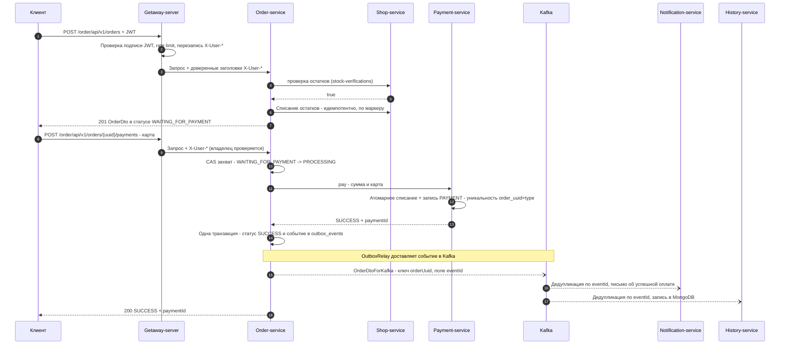

### 2. Товара нет или не хватает остатка

Проверка остатков (checkOrder) возвращает false — заказ не создаётся вовсе, клиент сразу получает понятную ошибку. Событие в Kafka не отправляется: финального исхода заказа ещё нет.

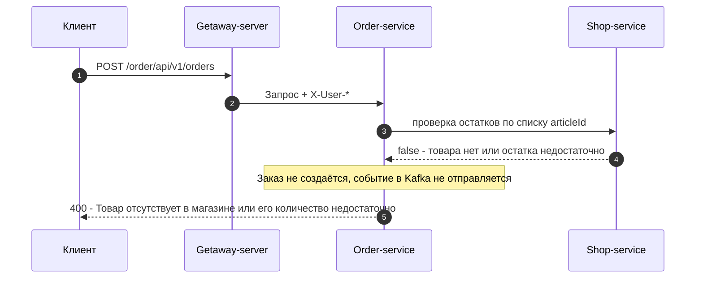

### 3. Недостаточно средств при оплате

Оплата отклоняется payment-service, списанные при создании остатки возвращаются в магазин, заказ — FAILED.

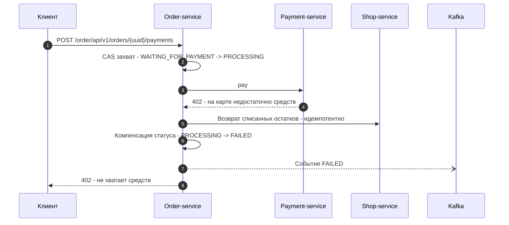

### 4. Возврат оплаченного заказа

Только владелец и только из SUCCESS; при сбое возврата средств заказ откатывается назад — застревание исключено.

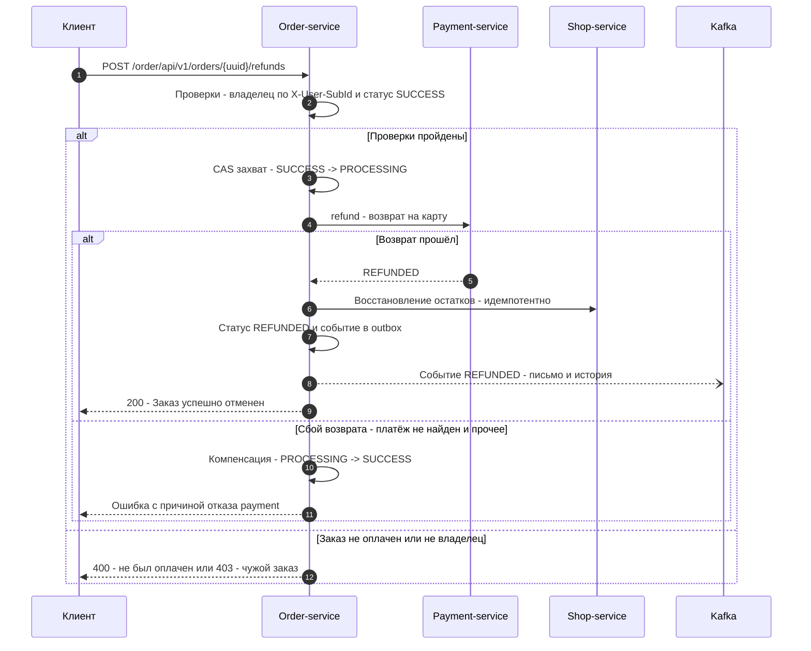

### 5. Transactional Outbox — гарантия доставки события

Событие и статус заказа фиксируются в одной транзакции БД; доставка в Kafka — отдельный фоновый процесс. Подробный разбор механики — в разделе «Надёжность» → «Kafka и Transactional Outbox».

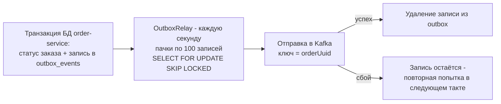

### 6. ReconciliationJob — самовосстановление застрявших заказов

Джоба каждые 60 секунд находит заказы, зависшие дольше 10 минут, и по фактическому состоянию payment приводит их к корректному статусу.

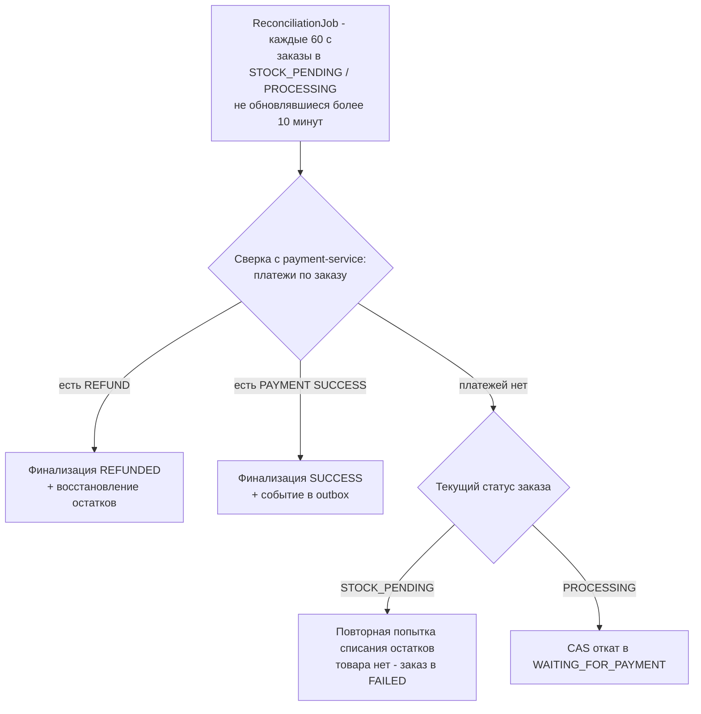

### 7. DLQ — сбой обработки не блокирует очередь

При ошибке обработки (например, временный троттлинг SMTP) запись ретраится и при исчерпании попыток уходит в мёртвую очередь.

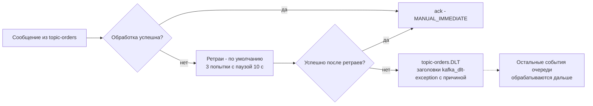

### 8. Аутентификация и доверие между сервисами

Gateway — единственная точка, где из JWT формируются доверенные заголовки; фоновые вызовы используют сервисный токен.

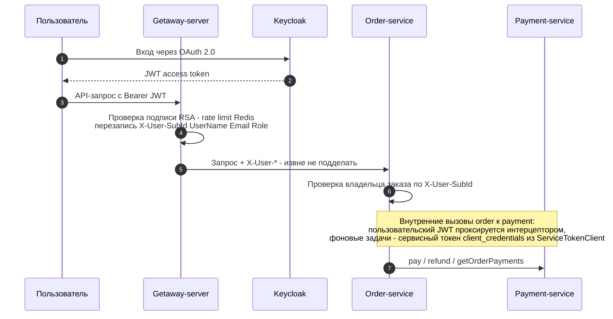

### 9. Доставка заказа курьером (auth-service + delivery-service)

Полный цикл: саморегистрация покупателя и курьеров, назначение курьера оплаченному заказу, 5-минутное окно возврата, стадии DELIVERING → DELIVERED.

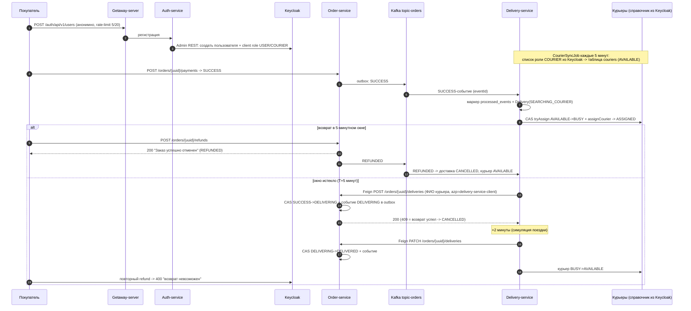

## Инструменты для просмотра метрик, логов и трассеров в проекте:

ELK - система для сбора, хранения и мониторинга логов в системе.

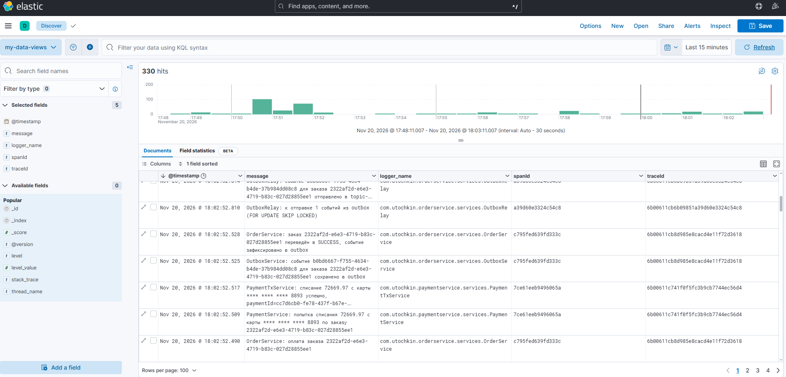

Prometheus и Grafana - для сбора и визуализации метрик.

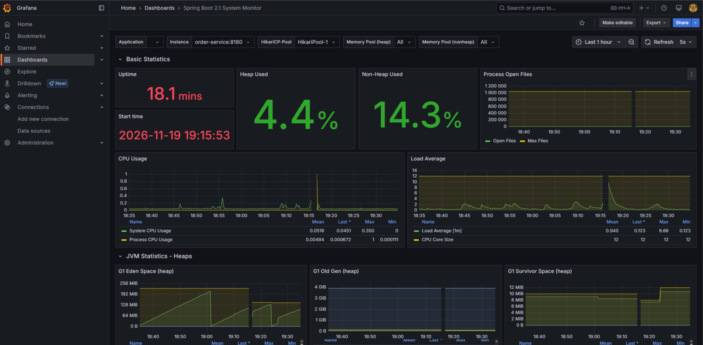

Zipkin - для сбора и визуализации трассировки между микросервисами.


## CI/CD

CI/CD реализован в среде Jenkins для сборки, тестирования сервисов, создания и пуша образов этих сервисов в DockerHub. 

