# [“Микросервисный проект магазина товаров (spring-microservices)”](https://github.com/Sergistan/spring-microservices)

## Описание

Микросервисный проект представляет собой RESTful API магазина товаров (доступен через Swagger, аутентификация — OAuth 2.0/Keycloak): пользователь может самостоятельно зарегистрироваться (покупателем или курьером) и удалить аккаунт, создать, оплатить и вернуть заказ (возврат возможен в 5-минутном окне после оплаты, затем заказ доставляет курьер с уведомлением по электронной почте и сохранением истории), а админ — добавлять, изменять и удалять товары магазина.

### Схема проекта:

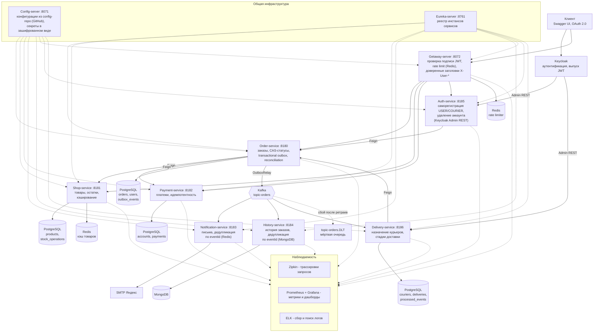

<details>
<summary>Что передаётся по связям схемы (легенда)</summary>

| Связь | Что ходит |
|-------|-----------|
| GW → AUTH | `POST /auth/api/v1/users` (анонимная регистрация, rate-limit 5/20), `DELETE /auth/api/v1/users/me` (JWT) |
| KC ⇄ AUTH | Admin REST: создание/удаление пользователя, назначение client role USER/COURIER (сервисный токен auth-service-client) |
| KC → DEL | Admin REST: список пользователей с ролью COURIER (синхронизация справочника курьеров, каждые 5 мин) |
| ORD ⇄ SHOP | Feign: проверка остатков, цена заказа, идемпотентные списание/восстановление остатков |
| ORD ⇄ PAY | Feign: pay / refund / сверка платежей (пользовательский JWT или сервисный токен) |
| AUTH → ORD | Feign: `GET /users/{subId}/has-active-orders` перед удалением аккаунта (сервисный токен, azp-гвард) |
| DEL → ORD | Feign: `POST /orders/{uuid}/deliveries` (T+5 мин, ФИО курьера) и `PATCH` (завершение); 409 = возврат успел раньше |
| ORD → KFK | OutboxRelay: события SUCCESS / FAILED / REFUNDED / DELIVERING / DELIVERED (ключ — orderUuid, eventId для дедупликации) |
| KFK → DEL | delivery-group: SUCCESS → создать доставку, REFUNDED → отменить |

</details>

## Список микросервисов:

- Config-server: используется для централизованного хранения и управления конфигурацией всех микросервисов. Все конфигурации микросервисов хранятся в репозитории [config-repo](https://github.com/Sergistan/config-repo);
- Eureka-server: регистрирует и хранит актуальные сведения о доступных инстансах сервисов и предоставляет их при запросе;
- Getaway-server: осуществляется единый и централизованный доступ ко всем микросервисам, а также обеспечение безопасности;
- Order-service: сервис для создания, оплаты и отмены заказа из магазина товаров;
- Shop-service: сервис из которого берется информация о возможности создания заказа при наличии товара в магазине, а также предоставляется возможность добавлять, изменять, удалять
  и получать товар/товары из базы данных магазина;
- Payment-service: сервис через который происходит оплата или возврат заказа. Также в базе данных этого сервиса хранится информация о банковском счете пользователей, которые производят оплату или возврат товара;
- History-service: сервис сохранения истории заказов (успешные, неуспешные и отмененные заказы) в nosql бд;
- Notification-service: сервис уведомления о статусе заказов (успешные, неуспешные и отмененные заказы) через электронную почту пользователя;
- Auth-service: саморегистрация пользователей (покупатель USER / курьер COURIER) и удаление собственного аккаунта через Keycloak Admin REST API. Перед удалением проверяет незавершённые заказы в order-service (Feign, сервисный токен);
- Delivery-service: доставка оплаченных заказов курьерами — третий консьюмер topic-orders (SUCCESS — создать доставку, REFUNDED — отменить), синхронизация справочника курьеров из Keycloak, конвейер стадий доставки (назначение курьера → T+5 минут DELIVERING → DELIVERED) с управлением статусом заказа в order-service через Feign.

## Основные технологии:

- Приложение разработано с использованием Spring Boot 3 и Java 21;
- Использован сборщик пакетов Gradle;
- Использованы sql-база данных PostgreSQL и nosql-база данных MongoDB;
- Использована система управления миграциями Liquibase;
- С помощью Swagger осуществляется отправка запросов через эндпоинты приложения;
- В order-service реализованы технологии Resilience4j (CircuitBreaker и Retry) тем самым минимизируется риск каскадных отказов и автоматически обрабатываются временные сбои;
- Регистрация, аутентификация и авторизация пользователей происходит через OAuth 2.0 с помощью Keycloak;
- Использовался Redis в микросервисе shop-service для кеширования результатов запросов и снижения нагрузки на основную БД, а также в getaway-server для rate limiting запросов и в notification-service для дедупликации событий;
- Использован брокер сообщений Kafka для одновременной и асинхронной отправки сообщений на микросервисы notification-service для уведомления пользователя о состоянии заказа и history-service для сохранения состояний заказа. Надёжность обеспечена паттерном Transactional Outbox, ручным подтверждением смещений (ack-mode MANUAL_IMMEDIATE), дедупликацией событий и мёртвой очередью topic-orders.DLT;
- Использовалась библиотека MailSender для оповещения пользователей в notification-service;
- Взаимодействие между микросервисами order-service и shop-service, а также payment-service настроено через Feign Client с обнаружением инстансов через Eureka;
- Для запуска используются Dockerfile и docker-compose;
- Код покрыт Unit-тестами с использованием JUnit5, Mockito для тестирования всех основных компонентов микросервисов, а также интеграционными тестами для каждого из микросервисов;
- Протестированы контроллеры с помощью WebMvcTest и репозитории с помощью DataJpaTest;
- Добавлены интеграционные тесты для тестирования работы кэша и отправки сообщений в брокер Kafka;
- Интеграционные тесты поднимают реальные инфраструктурные зависимости через Testcontainers (PostgreSQL, Kafka, MongoDB) — тесты работают только при запущенном Docker;
- Для отслеживания трассировки запросов через микросервисы настроен Zipkin;
- Для сбора и хранения метрик, а также визуализации этих метрик в микросервисах использованы Prometheus и Grafana;
- Для сбора, хранения и визуализации логов и событий в микросервисах использованы Elasticsearch, Logstash и Kibana;
- Для сборки, тестирования сервисов, создания и пуша образов этих сервисов в DockerHub в среде Jenkins используется Jenkinsfile.

## Надёжность и новые возможности:

Раздел описывает архитектурные улучшения, закрывающие гонки (race conditions), повышающие отказоустойчивость и безопасность системы.

### Устранение гонок и согласованность данных

- **CAS-переводы статусов заказа**: смена статуса выполняется атомарным UPDATE с условием `WHERE order_status IN (разрешённые статусы)` — два конкурирующих запроса не смогут перевести заказ дважды, проигравший получает 0 строк и корректно завершается;
- **Transactional Outbox**: событие для Kafka записывается в таблицу `outbox_events` в той же транзакции, что и статус заказа — невозможна ситуация «заказ оплачен, а событие потерялось». Фоновый OutboxRelay забирает пачки событий запросом `FOR UPDATE SKIP LOCKED` (параллельные инстансы не конфликтуют) и доставляет их в Kafka;
- **Идемпотентность платежей**: в payment-service запись о платеже защищена уникальным ограничением `(order_uuid, type)` — повторная оплата или возврат того же заказа возвращает тот же результат, а не создаёт дубль;
- **Идемпотентное списание остатков**: в shop-service каждая операция списания/восстановления остатков фиксируется маркером в `stock_operations` — повторная доставка команды (например, после сбоя сети) не изменит остаток второй раз;
- **Компенсационные откаты**: если возврат средств в payment завершился ошибкой, заказ откатывается из PROCESSING обратно в SUCCESS — заказ не «застревает» в промежуточном статусе;
- **Гонка «возврат vs доставка»**: и refund, и перевод в DELIVERING начинаются из SUCCESS и оба идут CAS-UPDATE в order-service — PostgreSQL отдаёт победу ровно одному; проигравший корректно разруливается (refunded → 400 «возврат невозможен», delivery → 409 → отмена доставки и освобождение курьера);
- **Атомарное назначение курьера**: занятие курьера и привязка его к доставке — два CAS (AVAILABLE→BUSY и SEARCHING_COURIER→ASSIGNED); два конкурирующих потока не займут одного курьера, а при отмене доставки курьер освобождается.

### Самовосстановление (ReconciliationJob)

Фоновая задача order-service каждые 60 секунд находит заказы, зависшие в `STOCK_PENDING`/`PROCESSING` дольше 10 минут (например, после падения сервиса в середине операции), сверяется с payment-service по фактическим платежам и приводит заказ к корректному финальному статусу: финализирует SUCCESS/REFUNDED, повторяет списание остатков или откатывает в WAITING_FOR_PAYMENT.

### Безопасность

- **Защита от IDOR**: операции с заказом (оплата, возврат, просмотр) доступны только его владельцу — чужой пользователь получает 403, даже зная orderUuid;
- **Доверенные заголовки X-User-***: getaway-server после проверки подписи JWT сам проксывает в сервисы идентификацию пользователя (sub, username, email, роль) в заголовках — подделать их извне нельзя, gateway перезаписывает их своими значениями;
- **Сервисный токен (client_credentials)**: внутренние вызовы order-service к payment-service для фоновых задач получают собственный OAuth2-токен через ServiceTokenClient (с кэшем) — не нужно хранить пользовательский JWT в фоновых процессах;
- **Service-to-service авторизация (azp)**: внутренние эндпоинты order-service (`POST/PATCH /orders/{uuid}/deliveries`, `has-active-orders`) принимают только сервисные токены ожидаемых клиентов (delivery-service-client / auth-service-client) — проверяется claim azp; обычный пользователь их вызвать не может;
- **Rate limiting**: маршруты order/shop/payment на getaway-server защищены ограничителем запросов на базе Redis (10 запросов/с, всплеск до 20; ключ — пользователь из JWT или IP для анонимов). Публичная саморегистрация `POST /auth/api/v1/users` — с отдельным лимитом 5/20 (анонимы ключуются по IP).

### Надёжная доставка в Kafka

- Потребители notification-service, history-service и delivery-service подтверждают смещения вручную (ack-mode MANUAL_IMMEDIATE) — только после успешной обработки;
- **Дедупликация событий**: каждый потребитель помечает обработанный eventId (Redis SETNX с TTL в notification-service, уникальный индекс в MongoDB в history-service, маркер processed_events в PostgreSQL в delivery-service) — при повторной доставке письмо не отправится дважды;
- **Ретраи и DLQ**: при сбое обработки (например, временный троттлинг SMTP) запись повторяется (по умолчанию 3 попытки с паузой 10 с), после чего переносится в мёртвую очередь `topic-orders.DLT` с заголовками причины — обработка остальных событий не блокируется.

### Инфраструктура

- Feign-клиенты находят сервисы через Eureka (без хардкода URL);
- Секреты не хранятся в git: ключ шифрования config-server передаётся через переменную окружения из локального `.env` (шаблон — `.env.example`), зашифрованные креды (`{cipher}...`) — в config-repo;
- Grafana при старте автоматически получает datasource Prometheus и дашборды JVM (Micrometer) и Spring Boot Statistics из каталога `grafana/provisioning` (версонируются в git);
- Ошибки запросов возвращают понятные 400-ответы с указанием проблемного поля (например, некорректный формат articleId) вместо стандартных заглушек Spring.

### Документация кода

Все классы, методы и репозитории покрыты javadoc на русском языке (назначение, гарантии целостности, потоки данных), пакеты `web`/`feign`/`dto` имеют `package-info.java` с описанием, какие данные и куда текут.

## Настройка стартовых пользователей в Keycloak:
В системе зарегистрированы 2 стартовых пользователя:  

**USERNAME:** sergistan **PASSWORD:** 111 (ADMIN)

**USERNAME:** umami **PASSWORD:** 222 (USER)

А также 3 стартовых курьера (client role COURIER, регистрируются через auth-service или создаются в админке):  

**USERNAME:** courier1 (Mikhail) **PASSWORD:** 111 · **USERNAME:** courier2 (Ivan) **PASSWORD:** 222 · **USERNAME:** courier3 (Dmitry) **PASSWORD:** 333

Для работы auth-service и delivery-service в realm дополнительно настроены (одноразово, вручную):
- client role **COURIER** у клиента spring-microservices;
- сервисные клиенты **auth-service-client** (realm-management: manage-users, view-users, view-clients) и **delivery-service-client** (view-users, view-clients) с включёнными Service accounts;
- роль USER или COURIER назначается автоматически при саморегистрации `POST /auth/api/v1/users`.

### Общая настройка Keycloak:
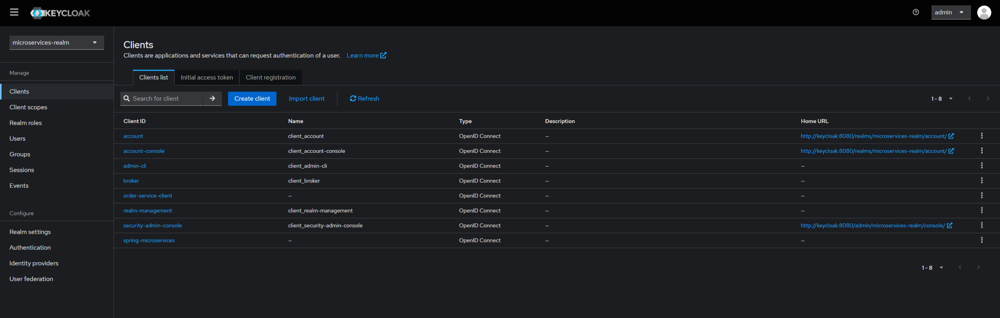


Настройка spring-microservices аналогична настройкам в auth-service-client и delivery-service-client


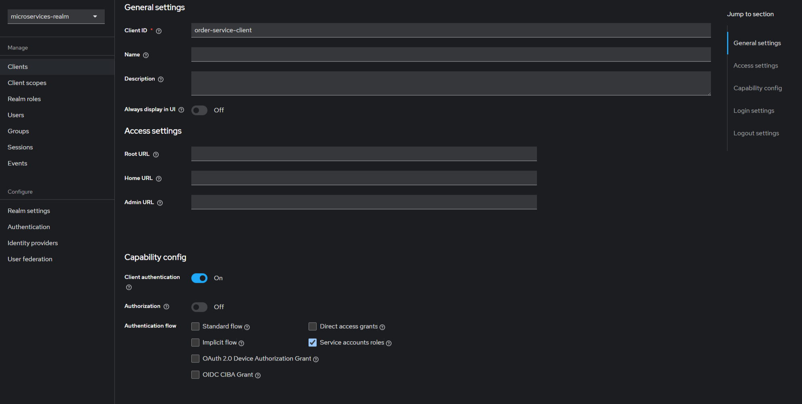

## Auth-service, Order-service API и Shop-service API в Swagger:

Эндпоинты для создания, оплаты, возврата заказов, добавления, изменения, удаления и получения товара/товаров,
саморегистрации пользователя/курьера и удаления аккаунта,
а также кнопка аутентификации посредством OAuth 2.0 с помощью Keycloak представлены в Swagger.


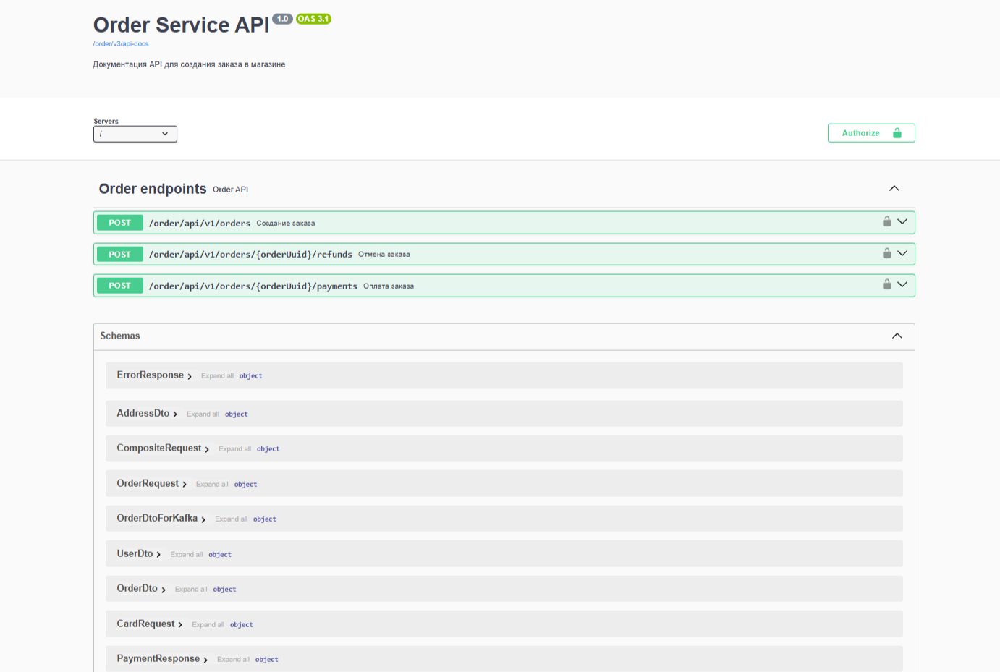

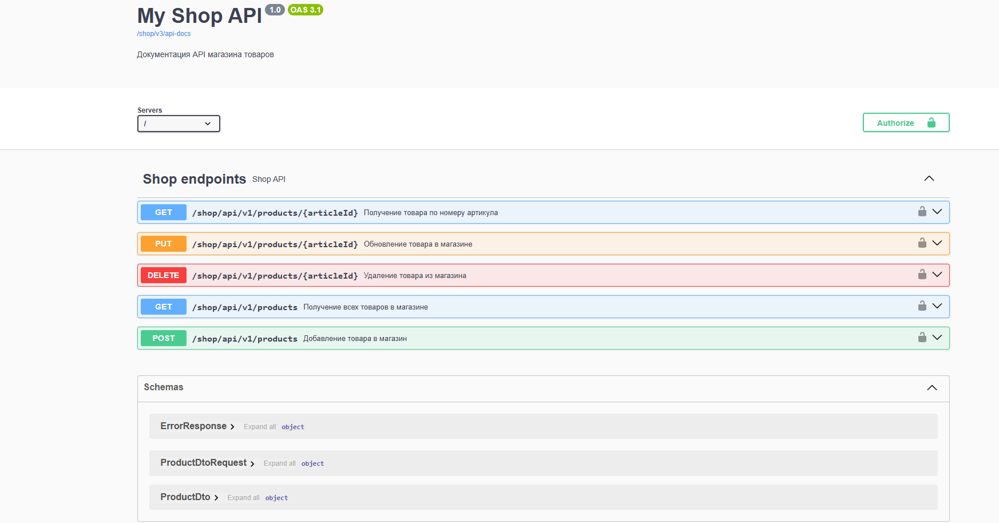

## Основной алгоритм работы проекта:

### Регистрация пользователя (Auth-service)

Новый покупатель или курьер регистрируется анонимно по /auth/api/v1/users (эндпоинт защищён отдельным rate-limiter 5/20 — анонимы ключуются по IP):

<details>
<summary>RegisterRequest</summary>

```json
{
  "username": "ivanov",
  "email": "ivanov@mail.ru",
  "firstName": "Иван",
  "lastName": "Иванов",
  "password": "Str0ngPass!",
  "role": "USER"
}
```
</details>

<details>
<summary>Описание полей в RegisterRequest</summary>

| Поле | Тип | Описание |
|------|-----|----------|
| `username` | `string` | Логин, 3–50 символов (латиница/цифры/`._-`), уникальный в realm |
| `email` | `string` | Электронная почта, уникальная в realm |
| `firstName` | `string` | Имя |
| `lastName` | `string` | Фамилия |
| `password` | `string` | Пароль, от 8 до 128 символов |
| `role` | `string` | Роль при регистрации: `USER` (покупатель) или `COURIER` (курьер). Зарегистрироваться как ADMIN нельзя |

---
</details>

Auth-service вызывает Keycloak Admin REST (сервисный токен auth-service-client): `POST /users` (создание с паролем) и назначение
client role USER/COURIER. Ответы: **201** — можно логиниться; **400** — ошибка валидации полей; **409** — username/email уже занят;
**503** — Keycloak недоступен. Курьеры попадают в справочник delivery-service при ближайшей синхронизации (раз в 5 минут).

### Удаление собственного аккаунта (Auth-service)

Удаление выполняется по /auth/api/v1/users/me (JWT; идентификация — доверенный заголовок X-User-SubId от гейтвея).
Перед удалением можно вызвать `GET /auth/api/v1/users/me` — «кто я»: возвращает данные текущего залогиненного
пользователя (sub, логин, ФИО, email, роль), чтобы убедиться, чей именно аккаунт будет удалён.
Перед удалением auth-service через Feign спрашивает order-service: `GET /order/api/v1/users/{subId}/has-active-orders`
(сервисный токен, azp-гвард) и delivery-service: `GET /delivery/api/v1/couriers/{subId}/active-deliveries-count`
(для курьеров — нельзя удалиться «в разгаре» доставки). Ответы: **204** — пользователь удалён из Keycloak; **400** — есть незавершённые заказы или активные доставки
(активными считаются и неоплаченные, и SUCCESS — после оплаты предстоит доставка); **404** — пользователя нет; **503** —
не удалось проверить заказы/доставки (сервис недоступен — удалять «вслепую» отказано). Завершённые заказы и история в Mongo сохраняются.

### Создание заказа:
Клиент создает заказ для покупки товара по /order/api/v1/orders и отправляет запрос:

<details>
<summary>CompositeRequest</summary>

```json
{
  "orderRequests": [
    {
      "articleId": "3873f81b-6d10-4860-97f4-0719eb88afaa",
      "quantity": 1
    }
  ],
  "addressDto": {
    "city": "Los Angeles",
    "street": "33th Avenue",
    "houseNumber": 233,
    "apartmentNumber": 112
  }
}
```
</details>

<details>
<summary>Описание полей в CompositeRequest</summary>

| Поле | Тип | Описание |
|------|-----|----------|
| `articleId` | `UUID` (string) | Идентификатор товара |
| `quantity` | `integer` | Количество товара |
| `city` | `string` | Город |
| `street` | `string` | Улица |
| `houseNumber` | `integer` | Номер дома |
| `apartmentNumber` | `integer` | Номер квартиры|
---
</details>

Затем через FeignClient OrderService обращается к ShopService, чтобы удостовериться, что такой товар по id есть в бд магазина 
и его количество в бд позволяет создать такой заказ. Если все условия соблюдены заказ создается 
(OrderService обращается к ShopService через FeignClient для подсчета итоговой стоимости заказа) возвращается 201 с ответом:

<details>
<summary>OrderDto</summary>

```json
{
  "orderUuid": "3f9edc4b-e4cf-4257-a485-72a147a0b45f",
  "totalAmount": 1000,
  "orderStatus": "WAITING_FOR_PAYMENT",
  "createdAt": "2025-01-12 13:56",
  "addressDto": {
    "city": "Los Angeles",
    "street": "33th Avenue",
    "houseNumber": 233,
    "apartmentNumber": 112
  },
  "userDto": {
    "username": "sergistan",
    "firstName": "Сергей",
    "lastName": "Уточкин",
    "email": "dzaga73i98@gmail.com"
  },
  "orderRequests": {
    "articleId": "3873f81b-6d10-4860-97f4-0719eb88afaa",
    "quantity": 1
  }
}
```
</details>

<details>
<summary>Описание полей в OrderDto</summary>

| Поле | Тип                         | Описание |
|------|-----------------------------|----------|
| `orderUuid` | `UUID` (string)             | Уникальный идентификатор заказа |
| `totalAmount` | `double`                    | Общая сумма заказа |
| `orderStatus` | `string`                    | Статус заказа (см. «Возможные статусы заказа») |
| `createdAt` | `string (yyyy-MM-dd HH:mm)` | Дата и время создания заказа |
| `city` | `string`                    | Город доставки |
| `street` | `string`                    | Улица доставки |
| `houseNumber` | `integer`                   | Номер дома |
| `apartmentNumber` | `integer`                   | Номер квартиры (опционально) |
| `username` | `string`                    | Логин пользователя |
| `firstName` | `string`                    | Имя пользователя |
| `lastName` | `string`                    | Фамилия пользователя |
| `email` | `string`                    | Электронная почта пользователя |
| `articleId` | `UUID` (string)             | Идентификатор товара в заказе |
| `quantity` | `integer`                   | Количество товара в заказе |

</details>

<details>
<summary>Возможные статусы заказа</summary>

| Статус | Значение |
|--------|----------|
| `STOCK_PENDING` | Заказ создаётся, остатки товаров ещё не списаны |
| `WAITING_FOR_PAYMENT` | Остатки списаны, заказ ожидает оплаты клиентом |
| `PROCESSING` | Идёт операция (оплата или возврат средств) — промежуточный захват статуса |
| `SUCCESS` | Заказ успешно оплачен (действует 5-минутное окно возврата) |
| `FAILED` | Заказ не выполнен (нет товара/остатков, не прошла оплата или списание) |
| `REFUNDED` | Оплаченный заказ отменён до начала доставки, средства и остатки возвращены |
| `DELIVERING` | Прошло 5 минут с оплаты: курьер принял заказ, возврат уже невозможен |
| `DELIVERED` | Заказ вручён покупателю — финальный статус |

Смена статусов выполняется атомарными CAS-переходами: заказ переходит из статуса в статус только из разрешённых предыдущих статусов, что исключает рассинхронизацию при конкурентных запросах.

</details>

После создания заказа в бд магазина уменьшается количество товара на количество указанное в заказе даже если заказ еще не оплачен, чтобы не было проблем 
с одновременным созданием заказов с одинаковыми товарами разными пользователями. Списание остатков идемпотентно: каждая операция фиксируется 
маркером в таблице stock_operations, поэтому повторная доставка команды (после сбоя сети или ретрая) не спишет товар дважды.

### Оплата заказа:
Оплата заказа осуществляется по /order/api/v1/orders/{orderUuid}/payments и отправляется запрос через FeignClient на PaymentService:

<details>
<summary>PaymentRequest</summary>

```json
{
  "orderUuid": "3f9edc4b-e4cf-4257-a485-72a147a0b45f",
  "cardNumber": "5078 6038 0721 8893"
}
```
</details>

<details>
<summary>Описание полей в PaymentRequest</summary>

| Поле | Тип | Описание                                 |
|------|-----|------------------------------------------|
| `orderUuid` | `UUID` (string) | Уникальный идентификатор заказа          |
| `cardNumber` | `string` | Номер банковской карты для оплаты заказа |
---
</details>

В случае ввода корректной банковской карты и при условии необходимого количества денег на ней для оплаты заказа возвращается 200 
с ответом. Оплата идемпотентна: повторный запрос по тому же заказу не спишет средства дважды — платёж защищён уникальным 
ограничением `(order_uuid, type)` в базе payment-сервиса, повторный вызов вернёт уже созданный платёж:

<details>
<summary>PaymentRequest</summary>

```json
{
  "paymentId": "3f9edc4b-e4cf-4257-a485-72a147a0b45f",
  "status": "SUCCESS"
}
```
</details>

<details>
<summary>Описание полей в PaymentRequest</summary>

| Поле | Тип | Описание                                 |
|------|-----|------------------------------------------|
| `paymentId` | `UUID` (string) | Уникальный идентификатор оплаты заказа   |
| `status` | `string` | Статус платежа (см. «Возможные статусы заказа») |
---
</details>

Если денег на счету банковской карты недостаточно для оплаты заказа, то статус меняется на FAILED.
В любом случае если оплата прошла или не прошла - OrderDtoForKafka отправляется в очередь kafka для HistoryService и NotificationService:
<details>
<summary>OrderDtoForKafka</summary>

```json
{
  "orderUuid": "3f9edc4b-e4cf-4257-a485-72a147a0b45f",
  "totalAmount": 1000,
  "orderStatus": "SUCCESS",
  "createdAt": "2025-01-12 13:56",
  "updatedAt": "2025-01-12 13:57",
  "addressDto": {
    "city": "Los Angeles",
    "street": "33th Avenue",
    "houseNumber": 233,
    "apartmentNumber": 112
  },
  "userDto": {
    "username": "sergistan",
    "firstName": "Сергей",
    "lastName": "Уточкин",
    "email": "dzaga73i98@gmail.com"
  },
  "orderRequests": {
    "articleId": "3873f81b-6d10-4860-97f4-0719eb88afaa",
    "quantity": 1
  },
  "paymentId" : "3f9edc4b-e4cf-4257-a485-72a147a0b45f",
  "eventId" : "98b0743e-64fc-4629-952f-9e3412c8c79b"
}
```
</details>

<details>
<summary>Описание полей в OrderDto</summary>

| Поле | Тип                         | Описание                                       |
|------|-----------------------------|------------------------------------------------|
| `orderUuid` | `UUID` (string)             | Уникальный идентификатор заказа                |
| `totalAmount` | `double`                    | Общая сумма заказа                             |
| `orderStatus` | `string`                    | Статус заказа (см. «Возможные статусы заказа»)  |
| `createdAt` | `string (yyyy-MM-dd HH:mm)` | Дата и время создания заказа                   |
| `updatedAt` | `string (yyyy-MM-dd HH:mm)` | Дата и время обновления заказа                 |
| `city` | `string`                    | Город доставки                                 |
| `street` | `string`                    | Улица доставки                                 |
| `houseNumber` | `integer`                   | Номер дома                                     |
| `apartmentNumber` | `integer`                   | Номер квартиры (опционально)                   |
| `username` | `string`                    | Логин пользователя                             |
| `firstName` | `string`                    | Имя пользователя                               |
| `lastName` | `string`                    | Фамилия пользователя                           |
| `email` | `string`                    | Электронная почта пользователя                 |
| `articleId` | `UUID` (string)             | Идентификатор товара в заказе                  |
| `quantity` | `integer`                   | Количество товара в заказе                     |
| `paymentId` | `UUID` (string)             | Уникальный идентификатор оплаты заказа         |
| `eventId` | `UUID` (string)             | Идентификатор события — по нему потребители дедуплицируют доставку (at-least-once не превращается в дубликаты писем/записей) |

</details>

### Отмена заказа:
Заказ можно отменить лишь при условии, что он был до этого успешно оплачен. Отменить заказ может только его владелец — 
при попытке отмены чужого заказа (по известному orderUuid) возвращается 403. Отмена заказа осуществляется по /order/api/v1/orders/{orderUuid}/refunds и отправляется запрос через FeignClient на PaymentService:

<details>
<summary>PaymentRequest</summary>

```json
{
  "orderUuid": "3f9edc4b-e4cf-4257-a485-72a147a0b45f",
  "cardNumber": "5078 6038 0721 8893"
}
```
</details>

<details>
<summary>Описание полей в PaymentRequest</summary>

| Поле | Тип | Описание                                                        |
|------|-----|-----------------------------------------------------------------|
| `orderUuid` | `UUID` (string) | Уникальный идентификатор заказа                                 |
| `cardNumber` | `string` | Номер банковской карты для возврата средств после отмены заказа |
---
</details>

В случае ввода корректной банковской карты возвращается 200 с ответом "Заказ успешно отменен". Статус в заказе меняется на REFUNDED 
и OrderDtoForKafka отправляется в очередь kafka для HistoryService и NotificationService с измененными данными.

Перед возвратом средств заказ атомарно захватывается CAS-переходом `SUCCESS → PROCESSING` (защита от одновременных возвратов). 
Если возврат средств в payment-service завершился ошибкой, заказ автоматически откатывается из PROCESSING обратно в SUCCESS — 
заказ не «застревает» в промежуточном статусе, а клиент получает понятную ошибку с причиной (например, «оплаченный заказ не найден»).

После отмены заказа в бд магазина увеличивается количество товара на количество указанное в возвращенном заказе (идемпотентно, 
по маркеру в stock_operations), а сумма средств потраченных на оплату заказа возвращается на указанную карту.

**Окно возврата — 5 минут.** Возврат возможен только пока заказ в статусе `SUCCESS`. Через 5 минут после оплаты delivery-service
переводит заказ в `DELIVERING` (курьер принял заказ) — с этого момента и после вручения (`DELIVERED`) возврат невозможен:
клиент получает 400 «Заказ уже передан в доставку или доставлен — возврат невозможен!». Гонка «возврат в последнюю секунду
окна vs перевод в DELIVERING» разрешается атомарно на стороне order-service (CAS из SUCCESS выигрывает ровно один).

Операции по проверке, созданию, оплаты и возврата заказа выполнены с технологиями CircuitBreaker и Retry для повышения отказоустойчивости системы.

### Создание, изменение, удаление и получение товара/товаров в ShopService.
Создание, изменение, удаление и получение товара/товаров в ShopService реализованы классическими CRUD операциями. 
Единственное ограничение заключается в том, что создание, изменение и удаление товаров в магазине может осуществлять только админ.
Также над CRUD операциями установлено кэширование через Redis для повышения производительности системы.
Эндпоинт на получение всех товаров в магазине создан с применением возможности сортировки, ограничения выдачи постранично с указанием нужного размера страницы.

### NotificationService и HistoryService
Событие в формате OrderDtoForKafka отправляется в Kafka при изменении заказа на **финальный статус**:
- `SUCCESS` — заказ успешно оплачен;
- `FAILED` — оплата не прошла (например, недостаточно средств);
- `REFUNDED` — оплаченный заказ отменён (до начала доставки);
- `DELIVERED` — заказ вручён покупателю.

Стадия `DELIVERING` (курьер принял заказ) тоже публикуется событием — по нему NotificationService отправляет письмо
«Ваш заказ принят курьером и доставляется по адресу … Ваш курьер: {ФИО}. Заказ будет доставлен в течение дня.»
(ФИО передаёт delivery-service, при DELIVERED повторное письмо не отправляется).

Промежуточные состояния (`STOCK_PENDING`, `WAITING_FOR_PAYMENT`, `PROCESSING`) событиями не сопровождаются. 
Если товар недоступен на этапе создания, заказ не создаётся и событие не отправляется — клиент сразу получает 400 с причиной. 
В NotificationService с помощью JavaMailSender происходит отправка сообщений о статусе заказов через электронную почту пользователя.


В HistoryService происходит сохранение истории заказов (успешные, неуспешные и отмененные заказы) в MongoDB.


### Доставка заказа (Delivery-service)

После оплаты (событие SUCCESS в topic-orders) delivery-service создаёт доставку и атомарно занимает свободного курьера
(CAS AVAILABLE→BUSY). Через 5 минут после оплаты планировщик вызывает внутренний эндпоинт order-service:

<details>
<summary>POST /order/api/v1/orders/{orderUuid}/deliveries (внутренний, только delivery-service по azp)</summary>

Запрос (ФИО назначенного курьера — попадёт в письмо покупателю):

```json
{
  "courierName": "Ivan Kurierov"
}
```

Ответ 200:

```json
{
  "orderUuid": "3f9edc4b-e4cf-4257-a485-72a147a0b45f",
  "orderStatus": "DELIVERING"
}
```

Ответ **409** — заказ уже не в SUCCESS (покупатель успел вернуть): delivery отменяет доставку (CANCELLED) и освобождает курьера.
Повтор при DELIVERING/DELIVERED идемпотентен — 200 без второго события.
</details>

Завершение доставки (через delivery.timing.deliver-after-minutes, по умолчанию 2 минуты) — `PATCH /order/api/v1/orders/{orderUuid}/deliveries`
(тот же azp-гвард): CAS DELIVERING→DELIVERED, событие DELIVERED в Kafka, курьер освобождается. Обе команды сопровождаются
событиями DELIVERING/DELIVERED в topic-orders → письмо «Ваш заказ принят курьером… Ваш курьер: {ФИО}. Заказ будет доставлен в течение дня.»
(при DELIVERED повторное письмо не отправляется) и запись в историю.

## Схемы взаимодействия сервисов:

Ниже — диаграммы основных сценариев. Полный happy path, сценарии сбоев и фоновые механизмы надёжности (outbox, reconciliation, DLQ).

### 1. Успешный заказ от начала до конца (happy path)

Клиент создаёт заказ, оплачивает его; событие об успешной оплате через outbox уходит в Kafka и доставляется в notification-service (письмо) и history-service (история).

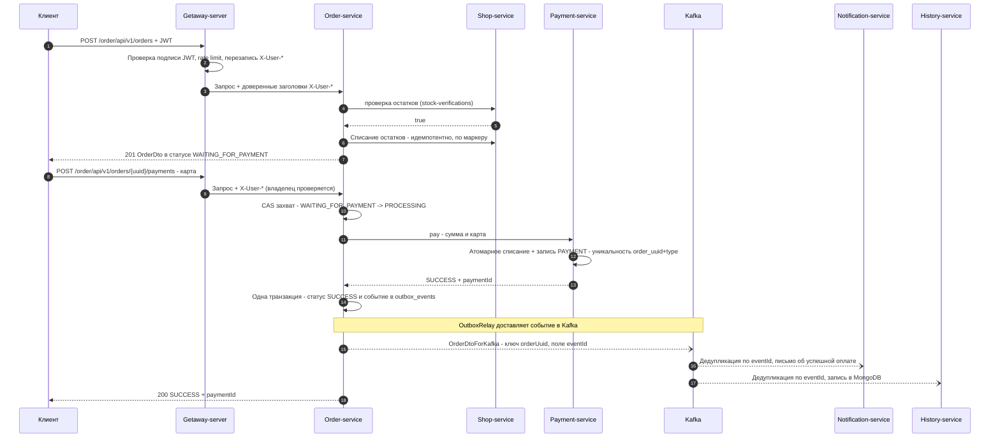

### 2. Товара нет или не хватает остатка

Проверка остатков (checkOrder) возвращает false — заказ не создаётся вовсе, клиент сразу получает понятную ошибку. Событие в Kafka не отправляется: финального исхода заказа ещё нет.

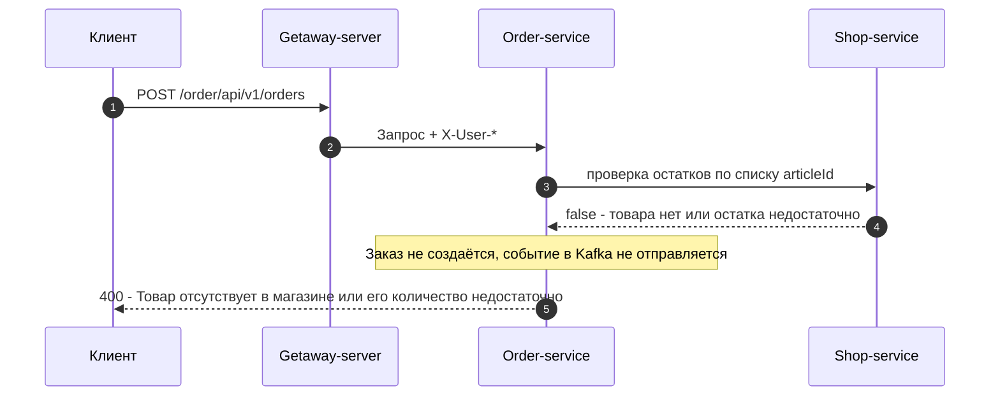

### 3. Недостаточно средств при оплате

Оплата отклоняется payment-service, списанные при создании остатки возвращаются в магазин, заказ — FAILED.

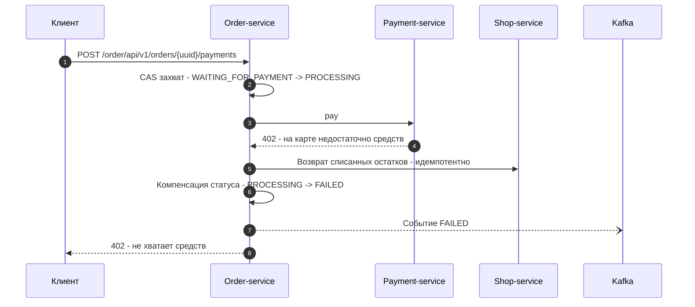

### 4. Возврат оплаченного заказа

Только владелец и только из SUCCESS; при сбое возврата средств заказ откатывается назад — застревание исключено.

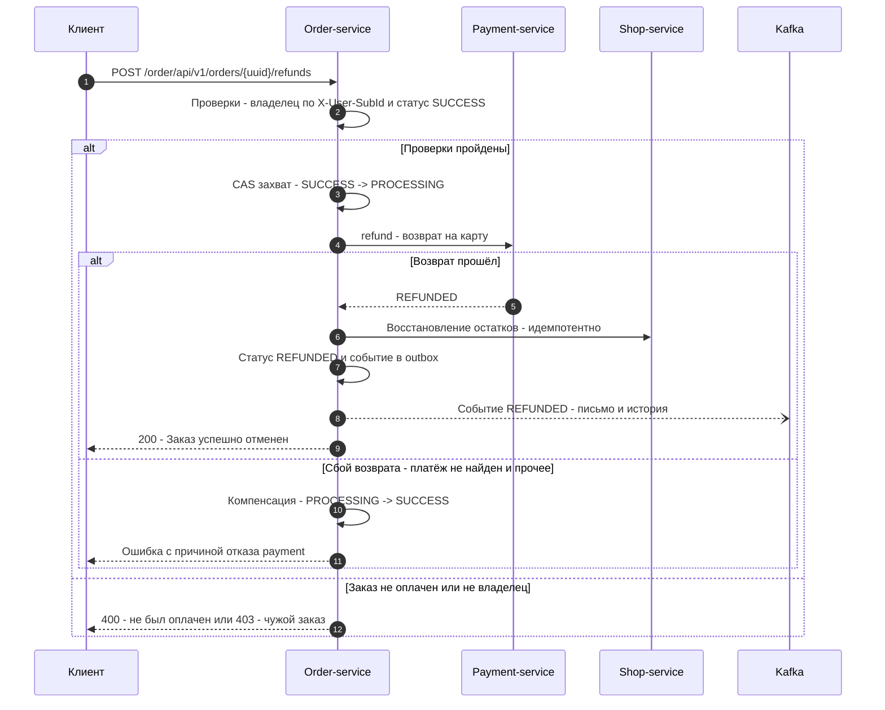

### 5. Transactional Outbox — гарантия доставки события

Событие и статус заказа фиксируются в одной транзакции БД; доставка в Kafka — отдельный фоновый процесс.

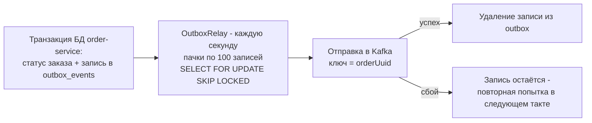

### 6. ReconciliationJob — самовосстановление застрявших заказов

Джоба каждые 60 секунд находит заказы, зависшие дольше 10 минут, и по фактическому состоянию payment приводит их к корректному статусу.

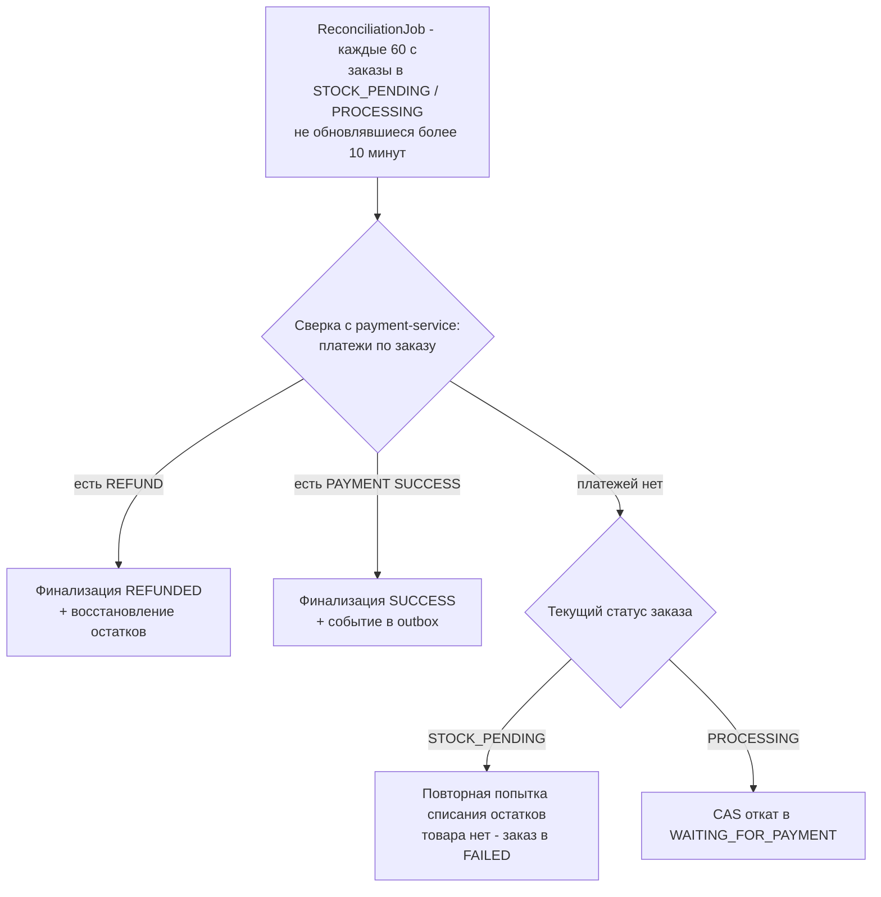

### 7. DLQ — сбой обработки не блокирует очередь

При ошибке обработки (например, временный троттлинг SMTP) запись ретраится и при исчерпании попыток уходит в мёртвую очередь.

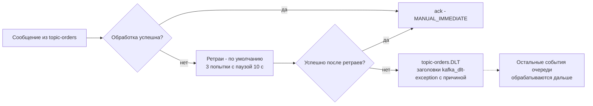

### 8. Аутентификация и доверие между сервисами

Gateway — единственная точка, где из JWT формируются доверенные заголовки; фоновые вызовы используют сервисный токен.

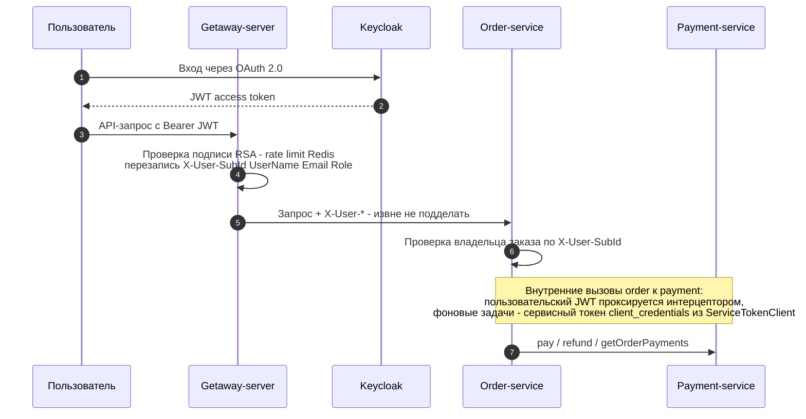

### 9. Доставка заказа курьером (auth-service + delivery-service)

Полный цикл: саморегистрация покупателя и курьеров, назначение курьера оплаченному заказу, 5-минутное окно возврата, стадии DELIVERING → DELIVERED.

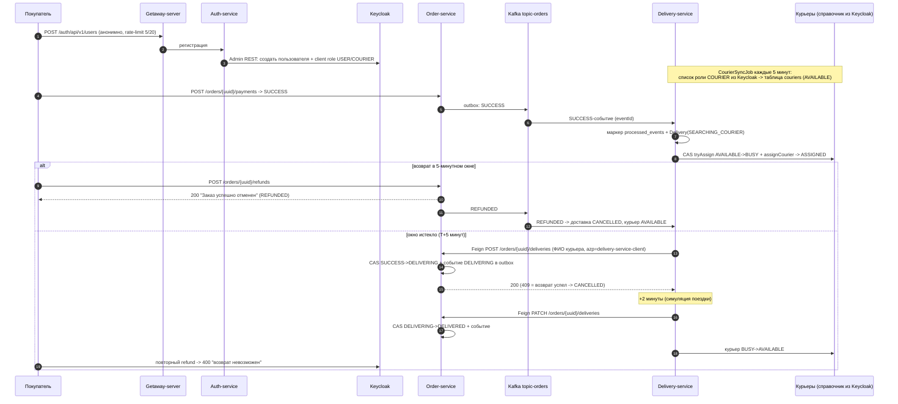

## Инструменты для просмотра метрик, логов и трассеров в проекте:

ELK - система для сбора, хранения и мониторинга логов в системе.


Prometheus и Grafana - для сбора и визуализации метрик.


Zipkin - для сбора и визуализации трассировки между микросервисами.

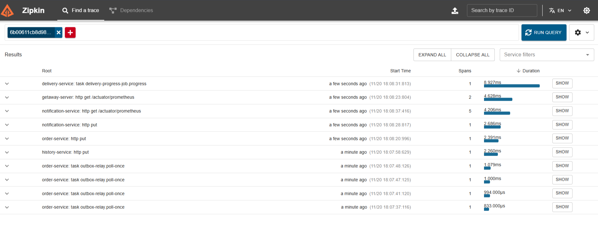

## CI/CD

CI/CD реализован в среде Jenkins для сборки, тестирования сервисов, создания и пуша образов этих сервисов в DockerHub. 

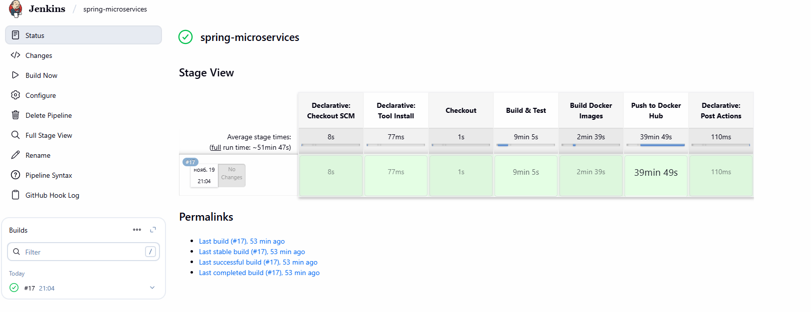